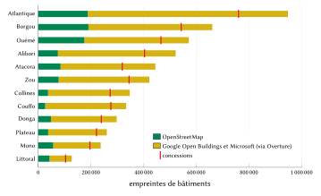
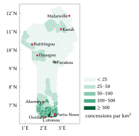
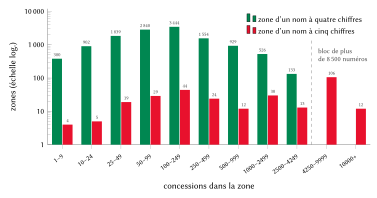
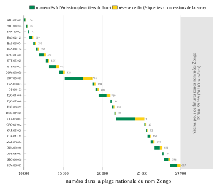
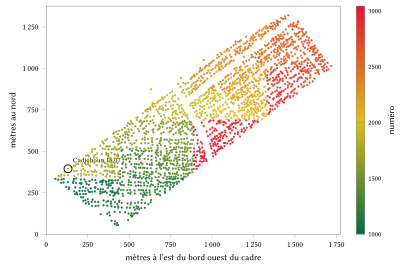
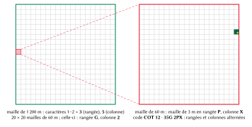

# Introduction

## Le problème

Une adresse remplit trois fonctions. Elle permet à une personne de dire où elle habite sous une forme dont un tiers peut se servir ; elle donne à une institution une référence stable vers un lieu ; elle conduit un visiteur, un livreur ou une équipe d’ambulance jusqu’au bon portail. Au Bénin, aucun système national ne remplit ces fonctions. La fiche d’adressage de l’Union postale universelle pour le pays ne comporte aucun champ de code postal : une adresse postale se compose d’un nom, d’une boîte postale, d’une localité et d’un numéro de téléphone [@upuBenin]. Cotonou codifie ses rues par arrondissement depuis 2013 et a peint des numéros de porte métriques sur une partie de ses façades [@hessoun2013; @osmwikiBenin], mais les plaques sont incomplètes et les données ne sont pas publiques. Le Conseil des ministres a autorisé le 22 avril 2026 une stratégie nationale d’adressage des voies et des portes [@sgg2026] ; à la date de rédaction, ni format, ni opérateur, ni calendrier n’a été publié. Partout ailleurs, on trouve une maison par son quartier, un point de repère et un appel téléphonique.

Le Bénin comptait 10 008 749 habitants au recensement de 2013 [@citypop]. La population se concentre au sud, dans l’agglomération du Grand-Nokoué (Cotonou 679 012 ; Abomey-Calavi 656 358 ; Porto-Novo 264 320 en 2013), Parakou (255 478) étant la principale ville du nord. La loi n° 2013-05 divise le territoire en 12 départements, 77 communes, 546 arrondissements et 5 290 villages et quartiers de ville [@loi2013_05]. Les formes d’habitat qu’un modèle d’adressage doit couvrir sont d’une diversité peu commune : concessions urbaines closes où plusieurs ménages partagent un même portail, chambres louées une à une autour d’une cour commune, maisons sur pilotis des villages lacustres de Sô-Ava que l’on rejoint en pirogue [@gouvSoAva], maisons fortifiées en terre (*tata somba*) de l’Atacora, et concessions de cases dispersées dans les champs du nord.

## Contributions

Cet article décrit un modèle d’adressage conçu pour le Bénin et le registre émis avec lui. Nos contributions sont les suivantes :

1. un code que l’on peut dire et retenir, composé d’un nom de lieu déjà en usage et d’un numéro court, et pourtant unique dans tout le pays à lui seul, sans commune, arrondissement ni position téléphonique à ajouter (sections 4.2 à 4.7) ;
2. une numérotation locale (des voisins reçoivent des numéros voisins), extensible (les nouvelles maisons et les nouvelles zones ne renumérotent jamais l’existant) et vérifiable dans les échanges entre machines (toute erreur sur un chiffre et toute inversion de deux chiffres voisins sont détectées, y compris celles qui tomberaient dans une autre zone du même nom) (sections 4.8 à 4.11) ;
3. un code de point métrique pour tout lieu, posé sur la projection du cadastre national (section 4.12), et une règle selon laquelle l’adresse de l’État s’affiche toujours en premier là où elle existe (section 4.13) ;
4. une mise en œuvre ouverte : une spécification, un moteur de référence, le registre complet de 4 147 741 codes et un serveur que tout organisme public peut déployer pour répondre exactement comme l’émetteur (section 5) ;
5. une évaluation mesurée du registre émis (section 6), un compte rendu des conceptions écartées et de leurs raisons (section 7), et des estimations sourcées des effets pour les citoyens, la logistique, les secours et l’administration (sections 8 à 11).

## Plan de l’article

La section 2 passe en revue les systèmes existants au Bénin et la pratique internationale. La section 3 décrit les données. La section 4 expose le modèle règle par règle, avec ses formules et un exemple calculé sur un code réel. La section 5 décrit la mise en œuvre et la section 6 évalue le registre. La section 7 rend compte des solutions envisagées. Les sections 8 à 11 traitent des bénéfices par secteur, la section 12 de la vie privée, de la sécurité et de la gouvernance, et la section 13 des limites. La section 14 conclut.

# Contexte et travaux existants

## L’adressage postal : des boîtes, pas des portes

Le Bénin n’a pas de code postal. La fiche d’adressage de l’UPU (datée de 11/2025) prévoit cinq lignes : destinataire, boîte postale, localité, numéro de téléphone et pays, avec l’exemple `10 BP 648 / COTONOU` [@upuBenin]. À Cotonou, Porto-Novo, Abomey et Parakou, les deux chiffres placés devant « BP » désignent le bureau de poste qui détient la boîte. Ils identifient un bureau, et non une zone, une rue ou une porte. Une boîte postale est donc conservée comme texte libre dans la fiche d’une concession et n’est jamais utilisée comme clé.

## L’adressage des rues à Cotonou

L’adressage de Cotonou a une longue histoire. Dans les années 1990, le registre foncier urbain (RFU), cadastre urbain simplifié financé par la coopération française à Cotonou, Porto-Novo et Parakou, associait une adresse géocodée (zone, îlot et parcelle) à une adresse postale par rue et par entrée ; l’étude de la Banque mondiale relève qu’aucune pose de plaques de rue ou de numéros de porte à l’échelle de la ville n’était prévue, et que le registre s’est révélé difficile à tenir à jour [@farvacque2005, p. 97–98]. Son coût d’investissement était d’environ 15 dollars des États-Unis par parcelle à Cotonou, 14 à Porto-Novo et 11 à Parakou [@farvacque2005, tableau 3.7].

Le plan actuel a été lancé le 12 novembre 2013 avec la coopération française, pour un coût d’environ 330 millions de francs CFA, en commençant par les 7^e^ et 12^e^ arrondissements [@hessoun2013]. Chaque rue reçoit un code formé de son arrondissement et d’un numéro à trois chiffres (« Rue 12.217 » est la rue 217 du 12^e^ arrondissement), et chaque porte un numéro à peu près égal au nombre de mètres depuis le début de la rue, impair d’un côté et pair de l’autre ; la résidence du maire était donnée comme « N° 43, Rue 12.217 » [@hessoun2013; @osmwikiBenin]. Les plaques et les numéros peints sont incomplets, aucun bilan postérieur à 2015 n’a été trouvé, et les données de portes de la commune ne sont pas publiques. Dans OpenStreetMap, 307 voies du centre de Cotonou portent un code du plan.

## La stratégie nationale d’avril 2026

Le 22 avril 2026, le Conseil des ministres a adopté le principe d’une stratégie nationale pour la normalisation et l’encadrement de l’adressage des voies et des portes, visant « un nouveau système d’adressage innovant et participatif, numérique et géolocalisé », et autorisé une mission avec un cabinet spécialisé pour la mettre en œuvre d’abord dans les villes du Grand-Nokoué (Abomey-Calavi, Cotonou, Ouidah, Porto-Novo, Sèmè-Podji) et à Parakou [@sgg2026; @bwt2026; @srtb2026]. Au 21 octobre 2026, aucun ministère, format, plateforme ou calendrier n’avait été publié. Le modèle décrit ici est conçu pour s’articuler avec ce programme : ses codes commencent par un nom de lieu et ne peuvent donc être confondus avec aucun code numérique émis par l’État, et le registre est publié de manière à pouvoir être mis en correspondance avec le système national ou lui être transféré.

## Le foncier n’est pas une adresse

Les droits fonciers sont régis par le code foncier et domanial (loi n° 2013-01 modifiée par la loi n° 2017-15) [@loi2017_15]. Le cadastre national de l’Agence nationale du domaine et du foncier (ANDF) identifie les parcelles par un numéro unique de parcelle, l’îlot et la parcelle, et le numéro de titre foncier, sur une carte en WGS 84 / UTM fuseau 31N [@andf]. Ces références désignent un terrain, pas l’endroit où s’arrête un livreur, et le modèle ne les utilise jamais comme adresses. La projection du cadastre est en revanche la grille naturelle des codes de point de la section 4.12.

## Pratique internationale et normes

La norme S42 de l’UPU définit les éléments des adresses postales et des gabarits de rendu par pays [@upuS42], et la norme ISO 19160-1 propose un modèle conceptuel de l’adressage qui permet de mettre des systèmes d’adresses en correspondance [@iso19160]. Toutes deux supposent qu’un système d’adresses existe ; aucune ne dit comment en créer un. L’ouvrage de l’UPU *Addressing the world* soutient que l’adresse est une condition préalable des services postaux, civiques et commerciaux [@upu2012]. L’étude de la Banque mondiale sur l’adressage des rues dans les villes africaines constitue le corpus le plus directement pertinent : dans 21 villes, 92 % des rues n’avaient pas de nom avant l’adressage, l’adressage classique a coûté en moyenne 5,7 dollars par porte et 0,6 dollar par habitant, et les systèmes se dégradent lorsqu’ils ne sont ni utilisés ni entretenus [@farvacque2005, tableau 3.1]. C’est pourquoi la conception de la section 4 part des noms que les habitants emploient déjà.

## Codes de grille et adresses numériques

Une seconde famille de systèmes dérive un code des seules coordonnées. L’Open Location Code (Plus Codes) code une maille de latitude et de longitude dans un alphabet de base 20 [@olc] ; des systèmes nationaux d’adresses numériques de la région, comme celui du Ghana, calculent un code pour toute position à partir d’une grille nationale [@ghanapost2017]. Ces codes sont universels et se passent de registre, mais ils ne portent aucun nom de lieu en usage, mêlent lettres et chiffres et donnent des codes différents à deux points d’une même concession. Les lettres posent une difficulté particulière au Bénin : en français, plusieurs noms de lettres riment (« cé », « pé », « vé »), et en fon, « c » se lit « tch », « x » note une fricative vélaire et « q » n’existe pas. Nous réservons donc le code de grille aux points qui ne sont pas des concessions (section 4.12) et donnons aux concessions un code enregistré, bâti sur un nom.

# Données et sources

Le modèle a été calculé à partir des données suivantes, dont les licences sont détaillées dans `SOURCES.md` et `LICENSING.md`.

- **Empreintes de bâtiments.** 5 174 482 empreintes : 1 040 021 issues d’OpenStreetMap [@neis2014; @geofabrik] et 4 134 461 des jeux de données Google Open Buildings [@sirko2021] et Microsoft [@msbuildings], repris par l’intermédiaire du thème « bâtiments » d’Overture Maps [@overture] là où OpenStreetMap n’a pas de bâtiment. La figure 1 présente les sources par département : OpenStreetMap fournit entre 8 % (Couffo) et 34 % (Littoral) des empreintes.
- **Lieux.** 13 443 points de lieu d’OpenStreetMap (quartier, village, hameau, voisinage, faubourg, ville, localité) de l’extrait du 17 octobre 2026, qui donnent leur nom aux zones de code.
- **Limites.** Les 546 arrondissements de geoBoundaries [@runfola2020] et les 77 communes du jeu de données opérationnel commun du Bureau de la coordination des affaires humanitaires des Nations unies [@ochaCod].
- **Rues officielles.** Les 307 voies du centre de Cotonou qui portent un code du plan de 2013 dans OpenStreetMap.
- **Murs, clôtures et portails.** Les enceintes et portails cartographiés dans OpenStreetMap, qui servent à regrouper les bâtiments en concessions.

{#fig:footprints width=92%}

La figure 2 montre la densité de concessions qui en résulte par commune, de moins de 25 au km² dans la plupart des communes du nord à environ 1 300 au km² à Cotonou et 1 400 à Porto-Novo.

{#fig:communes width=62%}

# Le modèle

## Exigences de conception

Nous avons fixé les exigences, par ordre de priorité, avant de choisir une forme :

1. **Mémorisable sans effort.** Un habitant doit pouvoir dire le code de mémoire après l’avoir entendu une fois, et l’obtenir en une étape.
2. **Unique à lui seul.** Le code doit désigner une seule concession du pays sans commune, arrondissement ni position.
3. **La concession et son portail.** L’unité est la concession ; ses bâtiments en sont des sous-unités ; la navigation s’achève au portail.
4. **L’État d’abord.** Là où l’État donne une adresse, elle s’affiche en premier, telle qu’il l’écrit.
5. **Jamais confondu avec un code officiel.** Le code ne doit ressembler ni à un code de rue de Cotonou, ni à une boîte postale, ni à un code numérique que l’État pourrait émettre.
6. **Hors ligne et stable.** Le code doit pouvoir se décoder sans réseau, ne jamais changer et ne jamais être réattribué.
7. **Des lieux, jamais des personnes.**

## Les formes d’un code

Chaque concession a trois formes d’un même code (tableau 1). La forme mémorisée est celle que l’on dit ; la forme écrite est le même texte avec son séparateur ; la forme machine est celle qu’échangent les systèmes.

| Forme | Exemple | Utilisée par |
|:--|:--|:--|
| Mémorisée | Cadjéhoun 18 07, dit « Cadjéhoun, dix-huit, zéro sept » | habitants, appelants, conducteurs |
| Écrite | Cadjéhoun · 18 07 | plaques, formulaires, colis, messages |
| Nom à cinq chiffres | Sainte Rita · 12 403, dit « douze, quatre cent trois » | les zones des 134 noms qui demandent cinq chiffres |
| Machine | BJ-COT-12-001-1807-4 | applications, codes QR, partenaires |
| Sous-unités | BJ-COT-12-001-1807-4.2 et /2 | bâtiment 2 de la concession ; entrée 2 |
| Point | COT 12 · 35G 2PX | tout lieu : un étal, un champ, un ponton |

: Les formes d’un même code. {#tbl:forms}

Soit $P$ le nom de plaque de la zone de la concession, $N$ son numéro, $C$ la clé de commune à trois lettres, $A$ le numéro d’arrondissement à deux chiffres, $Q$ l’indice à trois chiffres de la zone dans son arrondissement, $\iota$ l’indice national à cinq chiffres du nom de plaque et $c$ le chiffre de contrôle. Alors

$$
\text{écrite} = P \;\cdot\; \sigma(N), \qquad
\text{machine} = \texttt{BJ-}C\texttt{-}A\texttt{-}Q\texttt{-}N\texttt{-}c, \qquad
c = \operatorname{Damm}(\iota \,\|\, N)
\tag{1}
$$
où $\sigma(N)$ écrit un numéro à quatre chiffres en deux paires ($1807 \mapsto 18\ 07$, comme on lit les numéros de téléphone en français) et un numéro à cinq chiffres en une paire et une centaine ($12403 \mapsto 12\ 403$, comme on lit les codes postaux français), et où $\|$ désigne la concaténation de $\iota$ et de $N$, chacun écrit sur cinq chiffres. Le séparateur « · » distingue un nom qui se termine par un chiffre (« Ganvié 1 · 12 03 ») de son numéro ; il n’est pas nécessaire à la saisie. Le chiffre de contrôle ne figure que dans la forme machine : personne ne le voit, ne le dit ni ne le tape.

## Zones de code

La forme machine repose sur les 546 arrondissements des 77 communes. Une *zone de code* est un lieu nommé d’un arrondissement : un point de lieu d’OpenStreetMap ; un arrondissement sans lieu nommé forme une seule zone, d’indice 000. On compte 12 964 zones. Chaque empreinte $f$ prend le point de lieu le plus proche dans son propre arrondissement $\operatorname{arr}(f)$ :

$$
\operatorname{zone}(f) = \operatorname*{arg\,min}_{a \in \operatorname{arr}(f)}
\Big[ (\lambda_f - \lambda_a)^2 \cos^2 \varphi_f + (\varphi_f - \varphi_a)^2 \Big]
\tag{2}
$$
où $\varphi$ et $\lambda$ sont la latitude et la longitude. Les 18 374 empreintes qui ne tombent dans aucun polygone d’arrondissement (sur le littoral, les lagunes et les frontières) prennent le point de lieu le plus proche dans le pays. Chaque zone est figée à l’émission avec sa clé, son bloc de numéros et son *cadre* $(x_0, y_0, x_1, y_1)$ : le rectangle englobant des centres de ses empreintes, élargi de $0{,}0005^\circ$ (environ 55 m) de chaque côté. 12 845 zones contiennent des concessions ; la plus grande, Ladji Farani à Parakou, en compte 23 009. La figure 3 montre la distribution : la zone médiane compte 110 concessions.

{#fig:sizes width=95%}

## Concessions

Les empreintes sont regroupées en concessions avant toute numérotation, zone par zone et dans un ordre fixe d’identifiants stables (tableau 2). La distance entre deux empreintes $a$ et $b$ est la plus courte distance entre leurs contours :

$$
d(a,b) = \min_{p \in \partial a,\; q \in \partial b} \lVert p - q \rVert, \qquad d(a,b) = 0 \text{ si } a \cap b \neq \varnothing.
\tag{3}
$$

| Règle | Condition | Effet |
|:--|:--|:--|
| Enceinte | le centre de l’empreinte se trouve dans un mur, une clôture ou une haie fermés et cartographiés de 30 à 6 000 m² | l’enceinte forme une concession |
| Annexe | une empreinte de moins de 30 m² (cuisine, douche, guérite) | rejoint l’empreinte d’au moins 30 m² la plus proche si $d \le 6$ m |
| Groupe de cases | dans les communes rurales de l’Alibori, de l’Atacora, du Borgou et des Collines (hors Parakou) : cases de moins de 40 m² rattachées à aucune maison, avec $d \le 3$ m | une concession d’au plus 25 cases |
| Isolée | toute autre empreinte | sa propre concession |

: Les règles de regroupement, appliquées dans cet ordre. {#tbl:grouping}

Seules les annexes rejoignent une maison et un groupe de cases ne réunit jamais deux maisons ; les regroupements ne peuvent donc pas s’enchaîner à travers un quartier. Les règles ont produit 4 147 741 concessions à partir de 5 174 482 empreintes (1,25 empreinte par concession) : 3 329 544 bâtiments isolés, 739 537 maisons avec leurs annexes, 76 949 groupes de cases et 1 711 enceintes cartographiées. Les règles penchent délibérément vers la séparation des bâtiments. Fusionner deux codes plus tard ne coûte rien (le plus ancien demeure, l’autre devient un alias), alors que défaire une fusion erronée donnerait un nouveau code à un ménage. La section 6.6 en mesure la conséquence.

## Noms de plaque

Le nom d’un code se dit au téléphone et se peint sur un portail ; chaque zone porte donc, en plus de son nom officiel, un *nom de plaque* d’au plus 12 caractères et 2 mots. Avec $\mathrm{NFC}(s)$ la forme normale Unicode de $s$, comptée en caractères, et $L$ l’ensemble des mots de liaison,

$$
\operatorname{plaque\_ok}(s) \iff \lvert \mathrm{NFC}(s) \rvert \le 12 \;\wedge\; \lvert \operatorname{mots}(s) \setminus L \rvert \le 2,
\tag{4}
$$
où $L$ = {de, du, des, d’, la, le, les, l’, et, sur, en, au, aux, à, es} ; « es » est l’article arabe de noms comme Dar Es Salam. Les mots sont séparés par des espaces ou des traits d’union.

Un nom qui dépasse la limite passe par des étapes fixes, la première qui aboutit étant retenue : le nettoyage (le texte entre parenthèses ou après une barre oblique, ainsi que les génériques Quartier, Cité, Lotissement, Zone, Village et Campement, sont retirés, si bien que « Camp Peulh Soukoumpérou » devient **Soukoumpérou**) ; l’abréviation de « Saint » en « St » ; enfin la suite de mots entiers la plus distinctive, retenue seulement si elle devance nettement la candidate suivante, de préférence en fin de nom. Un mot n’est jamais coupé ; un mot de liaison personnel (Saint, Aladji, El Hadj, Orou, Bio, Sabi) ne perd jamais le mot qui le suit ; un qualificatif qui distingue deux lieux (Peulh, Bariba, Gando, Centre, Gare, un ordinal) n’est jamais supprimé automatiquement ; et un nom de plaque ne peut égaler un chef-lieu de commune, un département ou une grande ville, sauf s’il s’agit du nom propre de la zone. Le tableau 3 donne le résultat.

| Résultat | Zones |
|:--|--:|
| Nom de plaque identique au nom officiel | 11 134 |
| Raccourci par nettoyage | 70 |
| Raccourci par abréviation | 1 |
| Raccourci à ses mots les plus distinctifs | 460 |
| Laissé au choix de la commune, avec jusqu’à trois candidats | 1 300 |
| dont encore au-delà de la limite (surtout des mots uniques de plus de 12 lettres) | 681 |

: Comment ont été fixés les noms de plaque des 12 964 zones. {#tbl:plates}

Les 1 300 zones laissées au choix de leur commune ont été émises sous leur premier candidat, afin qu’aucun foyer n’attende une décision de dénomination : 391 974 codes portent un nom provisoire que la commune peut changer une fois. Le nom officiel reste un alias du nom de plaque (1 109 alias), si bien que la saisie du nom complet retrouve la même concession.

## La clé de nom

Deux noms de plaque sont un même nom lorsqu’ils se réduisent à la même clé,

$$
\kappa(s) = \operatorname{fold} \circ \operatorname{join} \circ \operatorname{ordinal} \circ \operatorname{article} \circ \operatorname{split} \circ \operatorname{lower} \circ \operatorname{unaccent} \circ \operatorname{gbe}(s),
\tag{5}
$$
dont les étapes sont détaillées au tableau 4. Le repliement suit les graphies par lesquelles un même son gbe ou yoruba s’écrit en orthographe française ; il peut réunir deux graphies d’un même nom, mais jamais scinder un nom en deux.

| Étape | Règle | Exemple |
|:--|:--|:--|
| gbe | ɔ → o, ɛ → e, ɖ → d, ŋ → ng, ƒ → f, ʋ → v, ɣ → g | Ɖokpa → Dokpa |
| accents, casse, découpage | accents et majuscules supprimés ; découpage sur tout caractère hors a–z et 0–9 | Gbèdji → gbedji |
| article, ordinal | le, la, les, l’ initial supprimé ; un chiffre romain ou un ordinal final devient son nombre | Ganvié I = Ganvié 1er → ganvie1 |
| jonction, repliement | mots accolés ; tch → c, dj → j, ph → f, ou devant voyelle → w, lettres doublées simplifiées | Ouèssè → wese ; Tchetti → ceti |

: Les étapes de la clé de nom, éq. (5). {#tbl:key}

Les 12 964 zones portent 10 841 noms de plaque distincts. 1 265 noms sont partagés, par 3 388 zones (26,1 %) regroupant 1 140 780 concessions ; les plus répétés sont Zongo (26 zones), Kpodji (20), Kpota (19), Gbèdji (15) et Fifadji (11).

## Plages nationales et blocs

Chaque nom possède une plage nationale : $[1000, 9999]$ pour un nom à quatre chiffres, $[10000, 99999]$ pour un nom à cinq chiffres. Soit un nom porté par les zones $1, \dots, k$, prises dans l’ordre figé de leurs clés (commune, arrondissement, zone) et comptant $n_1, \dots, n_k$ concessions à l’émission. Chaque zone reçoit un bloc de

$$
B(n) = \max\!\Big(200,\; 100 \left\lceil \frac{2n}{100} \right\rceil\Big)
\tag{6}
$$
numéros : deux fois ses concessions, en centaines entières, au moins 200. Avec $T = \sum_i B(n_i)$ le total du nom, son nombre de chiffres vaut

$$
\delta = \begin{cases} 4 & \text{si } T + 500 \le 9\,000, \\ 5 & \text{si } T + 5\,000 \le 90\,000, \end{cases}
\tag{7}
$$
et ses blocs sont posés depuis le bas de la plage, $F_1 = 10^{\delta-1}$ et $F_{i+1} = F_i + B(n_i)$, le haut de la plage restant libre pour les futures zones du même nom : au moins 500 numéros pour un nom à quatre chiffres et 5 000 pour un nom à cinq chiffres. Un nom qui ne satisferait aucune des deux conditions recevrait un qualificatif ; aucun nom au Bénin n’en a besoin. La plus grande plage, celle de Ladji Farani, utilise 46 100 de ses 90 000 numéros, et la plus grande plage partagée, celle de Gouré Tépel (deux zones), 38 800.

**Exemple : Cadjéhoun.** Une zone du 12^e^ arrondissement de Cotonou, de 2 046 concessions. Par l’éq. (6), $B(2046) = 100 \lceil 40{,}92 \rceil = 4100$ : le bloc est 1000–5099. Par l’éq. (7), $T + 500 = 4600 \le 9000$ : le nom a quatre chiffres, et 5100–9999 reste libre.

**Exemple : Agata.** Trois zones, à Allada (19 concessions), Cotonou (623) et Dangbo (217), avec les blocs 1000–1199, 1200–2499 et 2500–2999. $T = 2000$, le nom a donc quatre chiffres : **Agata · 15 00** se trouve à Cotonou, **Agata · 26 00** à Dangbo, et « Agata · 45 00 » n’appartient à aucun bloc : il est refusé, jamais deviné.

**Exemple : Zongo.** Le nom le plus répété : 26 zones dont les blocs totalisent 19 900 numéros. Comme $19\,900 + 500 > 9\,000$, le nom a cinq chiffres, avec les blocs 10000–29899 et 70 100 numéros libres (figure 4).

{#fig:zongo width=92%}

Sur les 10 841 noms, 10 707 ont quatre chiffres et 134 en ont cinq ; 12 665 zones ont quatre chiffres et 299 en ont cinq. Par concession, 3 241 198 codes (78,1 %) ont quatre chiffres et 906 543 (21,9 %) en ont cinq. Les zones à cinq chiffres sont surtout des villes qu’OpenStreetMap désigne par un seul point (Ladji Farani, Lokossa, Tanguiéta, Malanville, Porto-Novo) et les noms les plus répétés. Les blocs ne sont jamais déplacés, réduits ni renumérotés ; une nouvelle zone portant un nom existant, ou une zone dont le bloc est plein, prend le bloc suivant au-dessus de tous les blocs de son nom.

## Numérotation dans une zone

Les concessions sont numérotées le long d’une courbe de Hilbert [@hilbert1891] d’ordre 16 posée sur le cadre figé de la zone, de sorte que des concessions proches sur le terrain reçoivent des numéros proches [@moon2001]. Le point de référence d’une concession est son portail une fois confirmé, à défaut le centre de son plus grand bâtiment. Le point $(\lambda, \varphi)$ est d’abord ramené à la grille entière

$$
g_x = \left\lfloor \frac{\lambda - x_0}{x_1 - x_0}\,(2^{16}-1) \right\rfloor, \qquad
g_y = \left\lfloor \frac{\varphi - y_0}{y_1 - y_0}\,(2^{16}-1) \right\rfloor,
\tag{8}
$$
puis sa distance $h$ le long de la courbe est cumulée sur les bits de la grille, pour $s = 2^{15}, 2^{14}, \dots, 1$ :

$$
r_x = \Big\lfloor \frac{g_x}{s} \Big\rfloor \bmod 2, \quad
r_y = \Big\lfloor \frac{g_y}{s} \Big\rfloor \bmod 2, \quad
h \leftarrow h + s^2\,\big((3 r_x) \oplus r_y\big),
\tag{9}
$$
après quoi, si $r_y = 0$, le quadrant est tourné : si $r_x = 1$, alors $(g_x, g_y) \leftarrow (2^{16}-1-g_x,\; 2^{16}-1-g_y)$, puis $g_x$ et $g_y$ sont échangés. Ici $\oplus$ désigne le ou exclusif bit à bit. La figure 5 montre la courbe d’ordre 3. Les $n$ concessions d’une zone de bloc $[F, F+B)$, triées selon $(h, \text{identifiant stable})$ et indexées $i = 0, \dots, n-1$, reçoivent

$$
N_i = F + i \cdot \Delta, \qquad \Delta = \max\!\Big(1, \Big\lfloor \frac{M}{n} \Big\rfloor\Big), \qquad M = \Big\lfloor \frac{2B}{3} \Big\rfloor,
\tag{10}
$$
de sorte que les deux premiers tiers du bloc se répartissent sur les concessions actuelles et que le dernier tiers, $[F + M, F + B)$, constitue une réserve de fin laissée libre à l’émission.

{#fig:hilbert width=48%}

**Exemple : Cadjéhoun 18 07.** Le point de référence de la concession est $\varphi = 6{,}3582212$, $\lambda = 2{,}3911161$, et le cadre de Cadjéhoun est $(2{,}389926 ; 6{,}354647 ; 2{,}405961 ; 6{,}367091)$. Par l’éq. (8), $g_x = \lfloor 0{,}0011901/0{,}016035 \times 65535 \rfloor = 4863$ et $g_y = \lfloor 0{,}0035742/0{,}012444 \times 65535 \rfloor = 18823$ ; l’éq. (9) donne $h = 969\,741\,632$, soit la 808^e^ des 2 046 concessions le long de la courbe ($i = 807$). Avec $B = 4100$, $M = \lfloor 8200/3 \rfloor = 2733$ et $\Delta = \max(1, \lfloor 2733/2046 \rfloor) = 1$, l’éq. (10) donne $N = 1000 + 807 = 1807$ ; la réserve de fin va de 3733 à 5099. La figure 6 montre toutes les concessions de Cadjéhoun colorées selon leur numéro.

{#fig:cadjehoun width=92%}

## Nouvelles concessions

Une nouvelle concession prend la zone du code émis le plus proche dans un rayon de 250 m, afin de rejoindre ses voisins ; à défaut, la zone qui contient le point ; à défaut, la zone la plus proche. Dans la zone, soit $a$ le numéro de son prédécesseur sur la courbe (à sa position $h$ ou avant) et $b$ celui de son successeur. Elle reçoit

$$
N^{*} = \operatorname*{arg\,min}_{v \in (a, b) \setminus U,\; v < F + M} \Big( \Big\lvert v - \frac{a+b}{2} \Big\rvert,\; v \Big),
\tag{11}
$$
où $U$ est l’ensemble des numéros déjà attribués ou retirés ; si aucun $v$ ne convient, elle prend le plus petit numéro libre de la réserve de fin, et un bloc plein reçoit un bloc d’extension de son nom. À Cadjéhoun, $\Delta = 1$ : une maison bâtie entre deux voisins numérotés reçoit **Cadjéhoun · 37 33**, le premier numéro de la réserve de fin ; là où le pas est plus grand, les nouvelles maisons prennent des numéros entre leurs voisins.

## Décodage

Le décodage ne demande ni commune ni position :

$$
\operatorname{décoder}(P, N) = \big\{\, a \;:\; \kappa(P) \in \{\kappa(a)\} \cup \operatorname{alias}(a),\;\; \lvert N \rvert = \delta(\kappa(P)),\;\; N \in \operatorname{blocs}(a) \,\big\}.
\tag{12}
$$
Comme les blocs d’un nom sont disjoints, cet ensemble a au plus un élément. Le texte est lu comme un nom suivi d’un numéro de quatre ou cinq chiffres, avec ou sans séparateur, en paires ou non. Un numéro qui n’appartient à aucun bloc, qui se trouve dans l’espace libre du nom ou qui n’a pas le bon nombre de chiffres est signalé comme non émis, jamais deviné. Une commune écrite après une virgule doit être celle de la zone, sinon le code est refusé : « Agata · 15 00, Cotonou » est accepté, « Agata · 15 00, Dangbo » refusé.

## Le chiffre de contrôle

La forme machine porte un chiffre de contrôle calculé par l’algorithme de Damm [@damm2004] sur les dix chiffres $d_1 \dots d_{10}$ de $\iota \,\|\, N$ :

$$
c_0 = 0, \qquad c_k = T[c_{k-1}][d_k] \quad (k = 1, \dots, 10), \qquad c = c_{10},
\tag{13}
$$
où $T$ est la table d’opération d’un quasigroupe totalement antisymétrique d’ordre 10 (tableau 5). Un tel contrôle détecte toute erreur sur un chiffre et toute inversion de deux chiffres voisins.

| $T$ | 0 | 1 | 2 | 3 | 4 | 5 | 6 | 7 | 8 | 9 |
|:-:|:-:|:-:|:-:|:-:|:-:|:-:|:-:|:-:|:-:|:-:|
| **0** | 0 | 3 | 1 | 7 | 5 | 9 | 8 | 6 | 4 | 2 |
| **1** | 7 | 0 | 9 | 2 | 1 | 5 | 4 | 8 | 6 | 3 |
| **2** | 4 | 2 | 0 | 6 | 8 | 7 | 1 | 3 | 5 | 9 |
| **3** | 1 | 7 | 5 | 0 | 9 | 8 | 3 | 4 | 2 | 6 |
| **4** | 6 | 1 | 2 | 3 | 0 | 4 | 5 | 9 | 7 | 8 |
| **5** | 3 | 6 | 7 | 4 | 2 | 0 | 9 | 5 | 8 | 1 |
| **6** | 5 | 8 | 6 | 9 | 7 | 2 | 0 | 1 | 3 | 4 |
| **7** | 8 | 9 | 4 | 5 | 3 | 6 | 2 | 0 | 1 | 7 |
| **8** | 9 | 4 | 3 | 8 | 6 | 1 | 7 | 2 | 0 | 5 |
| **9** | 2 | 5 | 8 | 1 | 4 | 3 | 6 | 7 | 9 | 0 |

: Table du quasigroupe de Damm $T$ (ligne : chiffre intermédiaire $c_{k-1}$ ; colonne : chiffre suivant $d_k$). {#tbl:damm}

**Exemple.** L’indice national de Cadjéhoun est $\iota = 2362$ ; l’entrée est donc 02362 ‖ 01807. Les chiffres intermédiaires sont 0, 1, 2, 1, 9, 2, 2, 5, 3, 4 : $c = 4$, et la forme machine est BJ-COT-12-001-1807-4. Inverser les deux derniers chiffres (1870) donne le contrôle 3, et modifier le dernier chiffre (1808) donne 2 : les deux sont refusés.

Les chiffres de zone $C$, $A$ et $Q$ ne sont volontairement pas pris dans le contrôle. Le nom et le numéro fixent déjà la zone par l’intermédiaire des blocs figés : un validateur refuse donc une partie de zone altérée, puisque le numéro n’appartient qu’à un seul bloc. Introduire les chiffres de zone dans le calcul ferait varier deux entrées à la fois lorsqu’un numéro mal saisi tombe dans une autre zone du même nom, et la garantie de Damm ne tiendrait plus ; calculée sur $\iota \,\|\, N$, elle vaut pour tous les numéros du nom.

## Codes de point

Tout le Bénin se trouve dans le fuseau UTM 31N, projection du cadastre national ; les codes de point reposent donc sur une grille métrique de mailles de 3 m, carrées partout, de Cotonou (6,4° N) à Karimama (12,4° N). Un point est projeté par la série de Krüger au troisième ordre en $n$ [@kruger1912; @karney2011], exacte au millimètre près dans le pays. Chaque arrondissement possède un cadre dont l’angle sud-ouest $(e_0, n_0)$ est celui de son contour arrondi au kilomètre inférieur, avec $k_x$ et $k_y$ caractères de base 20 par axe (trois couvrent 24 km, quatre 480 km), dans l’alphabet `23456789CFGHJMPQRVWX`, qui ne contient ni voyelle ni caractère facile à confondre avec 0, 1 ou entre eux. Avec $(e, n)$ le point projeté,

$$
i_x = \Big\lfloor \frac{e - e_0}{3} \Big\rfloor, \qquad i_y = \Big\lfloor \frac{n - n_0}{3} \Big\rfloor,
\tag{14}
$$
et le code se compose de $C\,A$ suivi des chiffres en base 20 de $i_y$ et de $i_x$, entrelacés à partir des poids forts, ordonnée en premier, de sorte que des points voisins partagent leurs premiers caractères. 406 arrondissements demandent six caractères, 58 sept et 82 huit. Le point décodé est le centre de la maille, à au plus $1{,}5\sqrt{2} \approx 2{,}12$ m de tout point qu’elle contient.

**Exemple.** Le point de Cadjéhoun 18 07 se trouve dans le cadre du 12^e^ arrondissement de Cotonou ($e_0 = 429\,000$, $n_0 = 701\,000$, $k_x = k_y = 3$). Il se projette en $e = 432\,659{,}214$, $n = 702\,843{,}008$. Par l’éq. (14), $i_x = \lfloor 3659{,}214/3 \rfloor = 1219 = 3 \cdot 400 + 0 \cdot 20 + 19$ et $i_y = \lfloor 1843{,}008/3 \rfloor = 614 = 1 \cdot 400 + 10 \cdot 20 + 14$, dont les caractères sont 5 2 X et 3 G P. Entrelacés, ordonnée en premier, ils donnent **COT 12 · 35G 2PX** (figure 7). Le centre décodé se trouve à 0,87 m du point.

{#fig:spot width=95%}

**Points hors de tout contour.** Les contours d’arrondissement proviennent d’un jeu de limites généralisé : 13 999 concessions émises (0,34 %), surtout le long des frontières septentrionales de Ségbana, Malanville et Karimama, ne se trouvent dans aucun contour. Un tel point prend son arrondissement parmi ceux dont le contour se trouve à moins de 10 km : celui dont le contour est le plus proche et dont le cadre contient le point, la distance étant mesurée jusqu’à l’arête la plus proche, les écarts de longitude multipliés par $\cos\varphi$, et une égalité revenant à la clé de commune la plus basse, puis au plus petit numéro. Les cadres ne sont jamais déplacés ni élargis, car l’un comme l’autre changerait des codes de point déjà publiés ; un point qu’aucun de ces cadres ne contient prend donc la maille la plus proche d’un cadre situé à 999 m au plus. C’est le cas de 158 concessions à la frontière du Togo, dont le code de point désigne la maille du bord du cadre, à 392 m au plus du point de référence. Le décodeur ne change pas, puisqu’un code de point nomme son arrondissement. Ainsi, une concession de Monsey, à Karimama, en $\varphi = 12{,}2796011$, $\lambda = 2{,}9817464$, à 1,4 km au-delà du contour, tombe dans le cadre de Monsey et reçoit **KAR 05 · 349 RVMVH**.

## L’adresse officielle d’abord

Là où l’État donne une adresse, le modèle l’affiche en premier, telle qu’elle est écrite, avec le code N-Ways à côté. À Cotonou, la rue codée du plan de 2013 située à moins de 30 m d’une concession s’affiche en premier (« Rue 12.202, Cotonou ») ; 17 948 concessions en affichent une à l’émission. Un numéro de porte du plan, dès qu’il est connu pour un portail (par les données de la commune dans le cadre d’une convention de partage, ou lu sur la plaque par deux habitants indépendamment), remplace la rue. Lorsque le programme national livrera ses adresses, elles seront rattachées à leurs concessions de la même manière. Aucun code N-Ways ne change pour autant : le code demeure le moyen d’atteindre les concessions qu’aucune adresse officielle ne couvre encore, et de distinguer les ménages d’une concession qui partagent un portail.

## Le profil des bâtiments

Chaque bâtiment porte une classe d’usage, avec sa confiance et sa source, sa taille, ses niveaux lorsqu’ils sont connus et un statut. Les classes sont déduites dans un ordre fixe de preuves : le type de bâtiment d’OpenStreetMap (confiance 0,85), une étiquette de commerce, d’équipement ou de bureau sur l’empreinte (0,75), un lieu cartographié à l’intérieur (0,65), la taille de l’empreinte (0,3–0,4), et à défaut l’usage résidentiel (0,45). Sur les 5 174 482 bâtiments, 5 152 555 sont classés résidentiels, presque tous par défaut ; 6 651 sont des annexes, 6 413 des commerces, 2 960 des écoles, 1 182 des chantiers, 1 055 des établissements de santé, 1 054 des bureaux et 1 010 des lieux de culte. OpenStreetMap donne le nombre de niveaux de 3 968 bâtiments. Les hauteurs des jeux d’empreintes issus de l’apprentissage automatique ne prennent que 36 valeurs distinctes entre 3,5 et 7 m et ne sont pas utilisées. Une concession résidentielle ne porte jamais de nom.

# Mise en œuvre

## Spécification et moteur de référence

Le modèle est spécifié de manière normative dans `engine/SPEC.md`, avec les mots-clés d’exigence de la RFC 2119 [@rfc2119]. Le moteur de référence, `engine/reference/bj_engine.py`, met en œuvre chaque règle de la section 4 avec la seule bibliothèque standard de Python : analyse et validation des trois formes, clé de nom, table nationale des noms, chiffre de contrôle, codes de point et leur projection, regroupement en concessions et numérotation. Ses 38 tests couvrent chaque règle et les exemples de cet article. Un décodeur hors ligne a besoin d’environ 1,1 Mo pour la table des noms et ses alias (0,2 Mo compressés) et de 0,5 Mo de contours d’arrondissements ; pour afficher les codes des concessions, une application a besoin de la tranche du registre de sa commune (celle de Cotonou fait environ 2 Mo compressés).

## Le registre

Le registre est publié intégralement dans `registry/` : un fichier CSV compressé par commune, avec une ligne par code (formes machine, mémorisée et écrite, zone, nom officiel, numéro, chiffre de contrôle, statut, point et type d’entrée, code de point, adresse officielle le cas échéant, classe et usage du bâtiment, nombre de bâtiments, surface de plancher et règle de regroupement), la table figée des zones `areas.csv.gz` (12 964 zones avec leurs blocs, leurs noms, leur cadre et leur point de lieu), et `MANIFEST.json`, qui donne le nombre de lignes et l’empreinte SHA-256 de chaque fichier. Le registre contient tous les codes émis : 4 147 741 lignes dans 77 fichiers de commune. Tous les codes sont provisoires à l’émission et deviennent confirmés lorsque les habitants s’accordent dans l’application ; aucun n’a été retiré.

## Le serveur et son interface

Le dépôt comprend un serveur prêt à l’emploi, `server/`, que tout ministère, bureau de poste ou développeur peut déployer en une commande (`docker compose up`). Il importe le registre publié dans SQLite en vérifiant chaque fichier par rapport au manifeste, et sert une interface JSON sous `/v1` : la fiche complète d’un code, la recherche par forme mémorisée (quels que soient les espaces, la casse ou les accents), par forme machine, par adresse officielle ou par code de point, le code à un point donné et les codes voisins, la validation d’une forme machine, les codes de point dans les deux sens, ainsi que les communes et les zones avec leurs blocs. Le code à un point suit la règle de l’émetteur : la concession dont l’entrée se trouve à moins de 12 m. Un serveur désigné comme émetteur peut aussi émettre des codes pour de nouvelles concessions et des portes supplémentaires selon les règles des sections 4.8 et 4.9, et ses nouveaux blocs sont réécrits à l’export dans le format publié. L’export d’un import non modifié est identique, octet pour octet, aux fichiers publiés. L’interface est spécifiée dans `server/openapi.yaml` et documentée par des requêtes et réponses réelles dans `docs/api.md`. Un déploiement est en lecture seule s’il n’est pas l’émetteur désigné, car deux émetteurs travaillant indépendamment attribueraient deux fois le même numéro.

## Conformité et parité avec l’émetteur

Toute mise en œuvre doit reproduire les vecteurs de conformité de `engine/reference/vectors.json`, calculés sur le registre figé : 723 clés de nom, 500 jeux complets de formes, 2 393 décodages, 648 codes de point, 776 points hors de tout contour d’arrondissement (dont 456 concessions émises, des mailles les plus proches d’un cadre et des refus), 60 projections et les cas de numérotation. Nous avons en outre vérifié que le serveur émet exactement comme l’émetteur N-Ways : 530 nouvelles concessions et portes réparties dans dix zones, dont deux remplies jusqu’à recevoir des blocs d’extension, ont reçu les mêmes numéros et les mêmes formes des deux côtés, et 400 points ont donné la même zone, la même zone la plus proche et le même code de point. Un échantillon de 55 codes tirés au hasard, comparés champ par champ avec l’interface publique de l’émetteur (1 320 champs), n’a montré aucune différence.

# Évaluation

Toutes les valeurs de cette section sont mesurées sur le registre émis par `tools/paper-evaluation.py` et consignées dans `model/stats/evaluation.json`.

## Unicité et couverture

Aucune forme machine et aucune forme mémorisée (clé de nom et numéro) n’apparaît deux fois parmi les 4 147 741 codes. Chaque concession présente sur la carte à l’émission a un code : la couverture est de 100 % des concessions cartographiées, contre 0,4 % (17 948 concessions) qui peuvent afficher une rue officielle de Cotonou à moins de 30 m. Les 119 zones sans concession conservent leur bloc pour de futurs logements.

## Chiffres et longueurs

Sur les 4 147 741 codes, 3 241 198 (78,1 %) ont un numéro à quatre chiffres et 906 543 (21,9 %) à cinq. La forme écrite, séparateur et espaces compris, a une longueur médiane de 16 caractères ; 95,8 % des formes écrites ont 20 caractères ou moins, et la plus longue dont le nom de plaque respecte la limite, « Djèvié-Wadon · 10 000 », en a 21. Le nom de plaque tient en 12 caractères pour 4 046 845 codes (97,6 %) ; les 100 896 autres appartiennent aux 681 zones dont le nom provisoire dépasse encore la limite (section 4.5) et qui attendent le choix de leur commune. Les codes longs sont donc le fait d’un petit nombre de noms, non du modèle.

## Décodage

Pour un échantillon systématique d’une ligne sur vingt (207 387 codes), la forme écrite décodée seule par l’éq. (12), sans commune ni position, a redonné la forme machine dans tous les cas, et chaque forme machine a passé son contrôle. Le décodeur n’a besoin que de la table des noms de `model/names.json`.

## Erreurs de transcription

Le chiffre de contrôle n’étant pas montré aux personnes, une erreur dans un code mémorisé n’est détectée que si elle tombe hors des numéros émis du nom. Nous avons appliqué toutes les substitutions d’un chiffre et toutes les inversions de deux chiffres voisins au numéro d’un échantillon systématique de codes (tableau 6).

| Erreur dans le numéro | Erreurs | Autre code émis du nom | Numéro non émis dans un bloc | Hors de tout bloc (refusé) |
|:--|--:|--:|--:|--:|
| Substitution d’un chiffre | 1 533 235 | 67,0 % | 11,6 % | 21,4 % |
| Inversion de chiffres voisins | 106 986 | 64,0 % | 15,6 % | 20,4 % |

: Où aboutit une erreur dans le numéro d’un code mémorisé, pour un code sur cent du registre (41 477 codes). {#tbl:typos}

Dans la forme machine, le chiffre de contrôle a détecté la totalité de ces 1 640 221 erreurs, comme le garantit la construction de Damm. Dans la forme mémorisée, environ une erreur sur trois est refusée ou signalée comme non émise, et environ deux sur trois désignent une autre concession. Parmi celles-ci, 98,2 % se trouvent dans la même zone, parce que les numéros sont denses dans un bloc et ordonnés le long de la courbe de Hilbert ; la distance médiane à la concession visée est de 220 m (intervalle interquartile 71–719 m). Un code mémorisé est donc protégé non par un chiffre de contrôle mais par la relecture : l’application et l’opérateur répètent le lieu, et la carte montre la concession et son portail avant tout déplacement. La section 7.2 discute la solution alternative.

## Codes de point

Chaque code a un code de point. Pour un code sur vingt dont le point de référence se trouve dans son cadre (207 380 codes), le centre du code de point publié se trouve à une distance médiane de 1,20 m du point de référence de la concession, avec un 99^e^ centile de 1,97 m et un maximum de 2,12 m, borne théorique de la section 4.12. Les 13 999 codes (0,34 %) dont le point de référence ne se trouve dans aucun contour d’arrondissement du jeu de limites (section 13), surtout le long des frontières septentrionales de Ségbana, Malanville et Karimama, prennent l’arrondissement du contour le plus proche (section 4.12) ; 158 d’entre eux, à la frontière du Togo, se trouvent à l’ouest de tout cadre, et leur code de point désigne la maille du bord du cadre, à 392 m au plus du point de référence. Leur code de concession n’en est pas affecté.

## Regroupement en concessions

Pour éprouver le regroupement, nous avons rejoué les règles en masquant les 1 107 murs et clôtures cartographiés qui entourent au moins deux bâtiments. Parmi ces enceintes, 90 (8,1 %) ont donné une seule concession réunissant tous leurs bâtiments, dont 79 (7,1 %) sans aucun bâtiment extérieur au mur, et 438 autres (39,6 %) n’ont manqué qu’un bâtiment. Dans une concession béninoise, la maison principale, les chambres louées et la cuisine sont des bâtiments distincts, et en l’absence de mur cartographié les règles les maintiennent séparés à dessein (section 4.4). Le regroupement est donc une borne inférieure de la taille des concessions, à compléter par les habitants (« ces bâtiments forment une seule maison ») plutôt que par des règles plus lâches.

## Exemples

Le tableau 7 donne des codes réels du registre : la concession la plus proche de lieux connus.

| À proximité de | Forme écrite | Forme machine | Code de point |
|:-----------------------|:--------------------|:--------------------------|:-------------------|
| Rue 12.202, Cotonou | Cadjéhoun · 18 07 | BJ-COT-12-001-1807-4 | COT 12 · 35G 2PX |
| Marché Dantokpa, Cotonou | Dantokpa · 26 13 | BJ-COT-06-008-2613-1 | COT 06 · 353 9J2 |
| Zogbo, Cotonou | Zogbo · 27 90 | BJ-COT-09-004-2790-9 | COT 09 · 359 954 |
| Place de l’Étoile Rouge | Sainte Rita · 12 403 | BJ-COT-08-001-12403-1 | COT 08 · 33V MHV |
| Université d’Abomey-Calavi | Zogbadjè · 16 320 | BJ-CAL-02-020-16320-2 | CAL 02 · 25X 87C |
| Ganvié, Sô-Ava | Ganvié · 14 20 | BJ-SOA-04-002-1420-0 | SOA 04 · 74R 4X2 |
| Porto-Novo | Porto-Novo · 15 685 | BJ-PNO-04-004-15685-6 | PNO 04 · 35Q 8R6 |
| Ouidah | Ouidah · 12 920 | BJ-OUI-03-003-12920-0 | OUI 03 · 32W MRF |
| Abomey | Azali · 12 52 | BJ-ABO-06-008-1252-8 | ABO 06 · 48H 89V |
| Bohicon | Ahouamè · 27 02 | BJ-BOH-01-001-2702-8 | BOH 01 · 424 QHX |
| Parakou | Lémanda · 13 236 | BJ-PKO-02-013-13236-4 | PKO 02 · 724 8CH |
| Djougou | Timtim-Bongo · 10 96 | BJ-DJO-01-037-1096-4 | DJO 01 · 396 6FH |
| Natitingou | Natitingou · 13 13 | BJ-NAT-03-003-1313-2 | NAT 03 · H66 JVQ |
| Malanville | Malanville · 13 768 | BJ-MAL-04-005-13768-9 | MAL 04 · J7Q 2WG |

: Codes du registre émis. {#tbl:examples}

Un même nom en trois lieux : `agata 1500` se trouve dans le bloc 1200–2499, l’Agata de Cotonou ; `agata 2600` dans le bloc 2500–2999 de Dangbo ; l’Agata d’Allada détient 1000–1199. Rien n’est à choisir dans une liste et rien n’est deviné. Un système qui reçoit `BJ-COT-12-001-1870-4`, deux chiffres inversés, le refuse, puisque le contrôle de 1870 vaut 3.

# Solutions envisagées

## Variantes pour la forme

Avant de fixer la forme, nous avons comparé cinq conceptions au regard des exigences de la section 4.1, avec une règle de capacité imposant que les numéros disponibles valent au moins deux fois les concessions actuelles (tableau 8).

| Conception | Exemple | Calcul | Verdict |
|:--|:--|:--|:--|
| Chiffres nationaux seuls | 4817305 | $4{,}15 \times 10^6 \times 2 = 8{,}3 \times 10^6$ → 7 chiffres | trop long, et ne dit rien du lieu |
| Commune et chiffres | Cotonou 108417 | Abomey-Calavi : 378 856 concessions × 2 → 6 chiffres | trop long |
| Arrondissement et chiffres | Godomey 137081 | 206 arrondissements tiennent en 4 chiffres, 336 en demandent 5, 4 en demandent 6 | longueur variable ; hors des villes, l’arrondissement n’est pas le nom que l’on dit |
| Arrondissement et caractères de base 20 | Godomey 7HQ2X | $20^4 = 160\,000$ | lettres confondues au téléphone en français et en fon |
| **Nom de lieu et numéro dans une plage nationale par nom** | **Cadjéhoun · 18 07** | 12 665 des 12 964 zones tiennent en 4 chiffres | **retenue** |

: Conceptions comparées pour la forme mémorisée. {#tbl:designs}

Trois autres variantes ont été écartées. *Un Plus Code comme code* (par exemple 6FR4995R+7CQ) mêle lettres, chiffres et un signe, et se dicte mal en français comme en fon. *Le nom et le numéro avec la commune pour distinguer les homonymes* (par exemple « Zongo 48 17, Djougou ») échoue parce qu’une zone sur quatre partage son nom : la commune serait nécessaire tous les jours, et un code écrit sans elle serait ambigu. *Trois chiffres pour les petits villages* auraient convenu à environ 10 861 zones de 450 concessions ou moins, mais une longueur unique s’enseigne plus facilement (« toujours deux paires »), tient sur un seul modèle de plaque et ne change pas quand un village grandit. Le coût de la conception retenue est mesuré : partager une plage nationale et garder entières les grandes villes donne un cinquième chiffre à 21,9 % des concessions ; en contrepartie, aucun foyer n’a besoin d’autre chose que de son lieu et de son numéro.

## Variantes pour le caractère de contrôle

Un contrôle qui détecte toute erreur isolée et toute inversion de deux caractères voisins exige soit un alphabet de onze symboles avec un module premier, comme le « X » de l’ISBN-10, soit un schéma de quasigroupe sur dix chiffres comme ceux de Verhoeff [@verhoeff1969] ou de Damm [@damm2004]. Nous avons retenu l’algorithme de Damm parce qu’il repose sur une seule table, ne demande aucune permutation et garde la forme machine entièrement numérique. Nous avons aussi envisagé de placer un chiffre de contrôle dans la forme mémorisée. La section 6.4 montre ce qu’il apporterait : environ deux tiers des erreurs sur un chiffre dans un code mémorisé désignent une autre concession, en général à quelques centaines de mètres dans la même zone, et un chiffre de contrôle visible les détecterait. Il allongerait aussi d’un chiffre chaque code que l’on dit et que l’on peint, transformant deux paires en un groupe impair de cinq, alors que l’erreur dont il protège est précisément celle que la relecture du lieu et la carte révèlent avant tout déplacement. Nous gardons donc le chiffre de contrôle dans la forme machine, là où les codes passent d’un système à l’autre sans personne pour les relire, et nous nous appuyons sur la relecture pour la forme parlée. Les mesures prévues à la section 13 (erreurs de chiffres lors de la dictée des codes) diront s’il faut revenir sur ce choix.

## Choix fixés par la mesure

Plusieurs règles du modèle émis diffèrent de la première conception ; chacune a été fixée par une mesure.

- **Toutes les concessions, Cotonou compris.** Une première conception ne donnait pas de numéro N-Ways là où une porte était officiellement numérotée. Chaque concession a désormais un code, l’adresse officielle étant affichée en premier, afin que tout foyer puisse être atteint de la même manière.
- **Des blocs fondés sur les concessions réelles.** Les blocs sont dimensionnés sur les concessions effectivement regroupées, et non sur une estimation tirée d’un échantillon de bâtiments. L’estimation par échantillon donnait 47 noms à cinq chiffres (222 zones) ; le registre émis en compte 134 (299 zones).
- **Les grandes villes restent entières.** Le découpage des zones dont le bloc dépasse 8 500 numéros a été envisagé. Les 118 zones concernées prennent plutôt cinq chiffres et gardent un seul bloc, et leurs quartiers officiels deviendront des alias lorsque les communes les publieront.
- **Aucune hauteur empruntée.** Les hauteurs des empreintes issues de l’apprentissage automatique ne renseignent pas sur les niveaux et ne sont pas utilisées.

# Bénéfices pour les citoyens

Pour une famille dans une concession d’Agla, une maison sur pilotis de Ganvié ou un village du Borgou, un code change quatre choses ordinaires.

**Être trouvé.** Aujourd’hui, un visiteur, un conducteur de zémidjan ou un livreur se laisse guider au téléphone, repère après repère. Avec un code, l’habitant dit une phrase courte, « Cadjéhoun, dix-huit, zéro sept », et l’application conduit au portail.

**Justifier de son domicile.** Banques, agents de mobile money, écoles et employeurs demandent une adresse que presque personne ne peut écrire sous une forme vérifiable. À l’émission, 0,4 % des concessions peuvent afficher une rue officielle à moins de 30 m ; 100 % ont un code.

**Recevoir biens et services.** Les proches à l’étranger, les commerces et les services d’eau et d’électricité peuvent adresser un envoi à un code plutôt qu’à une description, et un ménage peut demander un branchement ou une réparation au bon portail.

**La simplicité.** Rien n’est demandé au ménage. Chaque concession figurant sur la carte a son code depuis le 20 octobre 2026, et l’application l’affiche en une étape. Il est gratuit, ne demande aucun document et ne contient aucune donnée personnelle. Ce n’est pas un titre foncier.

Le bénéfice est le plus grand pour les moins bien servis aujourd’hui : les villages éloignés des grands axes, les villages lacustres, les concessions de cases du nord, les locataires d’une concession qui partagent un portail, et les habitants qui lisent mal le français, pour qui un lieu qu’ils connaissent et deux paires de chiffres sont plus simples qu’un nom de rue.

# Logistique et commerce

La livraison au Bénin repose sur le téléphone et la moto. La forme machine donne à une entreprise de logistique une clé stable pour chaque client, se résout au portail (ou au bâtiment principal tant que le portail n’est pas confirmé), et porte un chiffre de contrôle qui intercepte à la saisie une forme machine mal tapée. Comme le registre et le moteur sont ouverts, toute entreprise peut résoudre les codes dans ses propres systèmes, hors ligne et sans frais. Le port de Cotonou dessert un corridor qui s’étend loin à l’intérieur des terres : importateurs, transitaires et commerçants de Dantokpa peuvent adresser marchandises et paiements à une concession, et une coopérative de coton ou de cajou du Borgou peut recenser les concessions de ses membres plutôt que leurs seuls villages. La Poste du Bénin peut livrer à un portail plutôt qu’à une boîte.

**Estimation.** Des sources professionnelles situent le coût moyen d’une tentative de livraison du dernier kilomètre en Afrique à environ 2,70 dollars et font état de taux de réussite au premier passage descendant jusqu’à 60 % [@odeloye2023]. Soit $f_0$ la part des premiers passages qui échouent, $\rho$ la part de ces échecs qu’un code précis supprime, et $c_a$ le coût d’une tentative. L’économie pour 1 000 livraisons vaut

$$
S = 1000 \cdot f_0 \cdot \rho \cdot c_a.
\tag{15}
$$
Avec $c_a = 2{,}70$ dollars, un cas central $f_0 = 0{,}20$ et $\rho = 0{,}5$ donne $S = 270$ dollars pour 1 000 livraisons. Sur les plages $f_0 \in [0{,}10 ; 0{,}40]$ et $\rho \in [0{,}25 ; 0{,}75]$, $S$ se situe entre 68 et 810 dollars. Ni $f_0$ ni $\rho$ n’ont été mesurés au Bénin ; la section 13 énumère les mesures qui permettraient de les fixer.

# Services de secours

Une ambulance, une équipe de pompiers ou une patrouille de police se heurte au même problème que le livreur, avec un enjeu plus lourd. Une étude qualitative des services médicaux d’urgence de Kigali a montré que la localisation des patients dépendait de la connaissance des lieux de l’appelant et de l’équipe et exigeait plusieurs appels [@hunt2023]. Les numéros d’urgence du Bénin sont le 112 (SAMU), le 116 et le 117 (police) et le 118 (sapeurs-pompiers) [@arcep2026] ; nous ne connaissons aucune mesure publiée de leur délai de localisation d’un appelant.

Un code aide l’opérateur en quatre temps. L’appelant dit une phrase (« Agata, quinze, zéro zéro ») et le registre renvoie une seule concession, à Cotonou, et non l’Agata de Dangbo ou d’Allada. L’opérateur relit le lieu, sa commune et le portail. L’équipe se rend au portail, et un code de point désigne un lieu qui n’est pas une concession, par exemple un accident sur une route nationale. Tout cela fonctionne hors ligne.

**Estimation.** Larsen et ses collègues ont modélisé la survie après un arrêt cardiaque extrahospitalier devant témoin en fibrillation ventriculaire comme 67 % moins 2,3 points de pourcentage par minute jusqu’à la réanimation cardio-pulmonaire, 1,1 par minute jusqu’à la défibrillation et 2,1 par minute jusqu’aux soins avancés [@larsen1993]. Lorsqu’une même équipe apporte les trois, un retard $\Delta t$ pour trouver le portail décale les trois délais, et la perte attendue de survie vaut

$$
\Delta P = (\beta_{\mathrm{RCP}} + \beta_{\mathrm{D}} + \beta_{\mathrm{SA}})\,\Delta t = 5{,}5\,\Delta t \quad \text{points de pourcentage},
\tag{16}
$$
soit 5,5 points pour une minute, 11 pour deux et 27,5 pour cinq, dans le domaine où le modèle linéaire reste valable. Ces chiffres proviennent d’un pays à revenu élevé et portent sur une catégorie précise d’arrêts ; pour le Bénin, ils donnent un ordre de grandeur, non une prévision.

# Coordination de l’administration et planification

Un code est une clé partagée. Lorsque ministères, communes, services publics de réseaux et institut national de la statistique désignent une concession par le même code, leurs fichiers peuvent être rapprochés sans apparier des noms et des descriptions.

**Une référence commune à tous les services.** Un répertoire d’adresses fournit une liste de locaux plus complète qu’un rôle d’imposition et fait apparaître qui en est absent [@farvacque2005]. Le programme national peut partir d’un registre de 4 147 741 concessions, chacune dotée d’une position et d’un code, et le registre peut être mis en correspondance avec ses adresses, ou lui être transféré, à mesure qu’elles sont livrées.

**Un code qui survit aux réformes.** Communes et arrondissements sont des libellés déduits de la position d’une concession. Quand une limite bouge, chaque code continue de fonctionner, et la clé de zone de la forme machine ne change pas.

**Le recensement.** Une table de correspondance entre codes et zones de dénombrement offrirait au prochain recensement une base de sondage de 4 147 741 concessions, où tirer des échantillons et revenir, sans conserver aucun nom.

**L’accès aux services.** Le tableau 9 donne les distances à vol d’oiseau d’un échantillon aléatoire de 20 000 concessions à l’équipement cartographié le plus proche. Elles décrivent autant la carte que le pays, car les postes de santé et de police des villages sont peu cartographiés ; un ministère peut remplacer la liste des équipements par la sienne et les recalculer en quelques minutes.

| Équipement | À moins de 2 km | À moins de 5 km | Distance médiane |
|:--|--:|--:|--:|
| Établissement de santé | 48,0 % | 70,7 % | 2,2 km |
| École | 50,4 % | 73,2 % | 2,0 km |
| Police | 19,7 % | 34,3 % | 8,9 km |
| Pharmacie | 24,9 % | 39,4 % | 7,9 km |

: Distance à vol d’oiseau de 20 000 concessions tirées au hasard à l’équipement cartographié le plus proche. {#tbl:access}

**Estimation.** Un relevé classique de numérotation des portes pour les mêmes concessions coûterait

$$
C = N \cdot c_d,
\tag{17}
$$
où $N = 4\,147\,741$ est le nombre de concessions et $c_d$ le coût par porte. Au coût moyen de 5,7 dollars par porte relevé par la Banque mondiale dans 21 villes africaines [@farvacque2005, tableau 3.1], $C \approx 23{,}6$ millions de dollars ; au coût par parcelle du registre foncier urbain de Cotonou (11 à 15 dollars [@farvacque2005, tableau 3.7]), $C$ se situe entre 45,6 et 62,2 millions de dollars. Ces deux coûts s’entendent aux prix de leur époque et hors entretien. Le registre ne remplace pas la signalisation, que l’État peut toujours décider d’installer, mais il supprime l’étape du relevé et de la numérotation et fournit la liste des concessions que la signalisation suivrait.

# Vie privée, sécurité et gouvernance

**Vie privée.** Les codes décrivent des lieux, jamais des personnes. Les concessions résidentielles ne portent ni nom ni donnée sur leurs occupants ; les commerces et les bâtiments publics peuvent afficher le nom qu’ils publient. Aucun numéro d’identité n’est collecté et rien ne relie un code à un identifiant personnel. Le traitement de données personnelles dans l’application (numéros de téléphone, photographies de portail) relève du livre V du code du numérique, sous le contrôle de l’Autorité de protection des données à caractère personnel (APDP), qui exige une déclaration préalable et une autorisation pour les transferts à l’étranger et les interconnexions de fichiers [@loi2017_20]. Un ménage peut demander que son entrée soit masquée sur la carte publique ; le code reste valable pour un visiteur qui le connaît.

**Sécurité.** Une adresse n’est ni un titre foncier ni une liste d’expulsion. Les données au niveau de la concession qui vont au-delà du registre publié (qui a confirmé quoi, photographies, descriptions des ménages) ne sont communiquées que sur décision de justice, avec un compte rendu public de la demande.

**Gouvernance.** Un émetteur unique tient le registre, afin que deux concessions ne partagent jamais un code. Zones, blocs et cadres sont figés, les codes ne changent jamais, et un regroupement ne modifie jamais un code émis : si deux concessions se révèlent n’en faire qu’une, le code le plus ancien demeure et l’autre devient un alias ; si une concession se révèle en être deux, la partie qui a le portail garde son code. Une commune peut renommer une zone (l’ancien nom reste un alias), choisir une fois un nom de plaque provisoire ou ajouter des zones. Les adresses de Cotonou et celles du programme national appartiennent à l’État : le modèle les affiche telles qu’elles sont écrites, ne les modifie jamais et signale à leur détenteur toute incohérence constatée sur le terrain. Le dépôt est organisé pour pouvoir être transféré à l’État ou à l’organisme qu’il désigne, sous ses licences ouvertes, sans scission du moteur.

# Limites et travaux futurs

- **La liste des zones repose sur OpenStreetMap.** Les points de lieu sont inégalement cartographiés ; noms et graphies demandent la confirmation des habitants et des communes, et les villes cartographiées par un seul point forment de très grandes zones à cinq chiffres. Lorsque l’annexe de la loi n° 2013-05 sera disponible sous forme exploitable par machine, ses noms seront rattachés aux zones comme alias.
- **Noms de plaque provisoires.** 1 300 noms de plaque, dont 681 au-delà de la limite, attendent le choix de leur commune.
- **Les concessions sont déduites.** Peu de murs sont cartographiés ; la plupart des concessions sont des bâtiments isolés ou une maison avec ses annexes (section 6.6).
- **L’usage des bâtiments est surtout une valeur par défaut**, et le nombre de niveaux est presque toujours inconnu.
- **Limites administratives.** Les contours d’arrondissements proviennent de geoBoundaries et non d’un fichier officiel, et sont inexacts par endroits (deux arrondissements de Cotonou manquent ; les contours de Sô-Ava placent mal Ganvié). Comme la zone de chaque concession est figée dans le registre, un contour corrigé ne change aucun code.
- **Données officielles.** Les numéros de porte de Cotonou ne sont pas ouverts ; tant qu’ils ne sont pas partagés, Cotonou affiche ses rues, et les numéros de porte seulement là où les habitants les confirment.
- **Les portails sont largement inconnus** : la plupart des codes mènent au bâtiment principal tant que les portails ne sont pas confirmés.
- **Codes de point aux frontières.** 13 999 concessions dont le point de référence se trouve hors de tout contour d’arrondissement prennent l’arrondissement du contour le plus proche pour leur code de point (section 6.5) ; pour 158 d’entre elles, à la frontière du Togo et à l’ouest de tout cadre, le code de point désigne la maille du bord du cadre, jusqu’à 392 m, car les cadres ne bougent jamais. Un contour corrigé ne change aucun code de concession.
- **Erreurs dans la forme parlée.** Deux tiers des erreurs sur un chiffre dans un code mémorisé désignent une autre concession émise (section 6.4) ; la relecture et la carte en sont la protection, et leur efficacité reste à mesurer.

Les travaux futurs mesureront ce que supposent les estimations des sections 9 à 11 (tableau 10).

| Mesure | Méthode | Objectif |
|:--|:--|:--|
| Rappel de son propre code après une semaine | habitants interrogés sans l’application, en français, en fon et en bariba | au moins 80 % exacts |
| Erreurs de chiffres lors de la dictée d’un code au téléphone | appels enregistrés avec des livreurs partenaires | moins de 5 % |
| Réussite de la livraison au premier passage | livreurs partenaires, avec et sans code | au moins 20 points de plus |
| Temps entre l’arrivée dans le quartier et le portail | horodatage de l’application des livreurs | divisé par deux |
| Portails confirmés ; numéros de porte rattachés à Cotonou | habitants et livreurs | 50 000 |

: Mesures prévues pour remplacer les hypothèses des estimations d’impact. {#tbl:measures}

# Conclusion

Le Bénin n’a pas de code postal et, hors d’une partie de Cotonou, pas d’adresse à la porte. Nous avons montré qu’une adresse peut être donnée à chaque concession du pays sous une forme que les habitants connaissent déjà à moitié : le nom de leur quartier ou de leur village et deux paires de chiffres. Une plage nationale unique par nom rend le code unique à lui seul ; des blocs figés, dimensionnés sur les concessions réelles, avec une réserve de fin et un espace libre, le rendent stable à mesure que le pays construit ; une numérotation ordonnée par la courbe de Hilbert le rend local ; et un chiffre de contrôle caché dans la forme machine le rend sûr à échanger. Le registre de 4 147 741 codes a été émis le 20 octobre 2026 et il est publié intégralement avec sa spécification, son moteur de référence et son serveur, afin que l’État, ou tout organisme qu’il désigne, puisse vérifier chaque règle, répondre exactement comme l’émetteur et reprendre le registre.

# Disponibilité des données et du code {-}

La spécification, le moteur de référence, le registre, le serveur, les outils et cet article sont publiés à l’adresse <https://github.com/n-ways/open-addresses-benin>. Le code est sous licence Apache 2.0, les données sous Open Database License 1.0 et les documents sous CC BY 4.0. Toute utilisation doit porter la mention : « N-Ways Addressing for Benin, © N-WAYS LIMITED (nways.ng) ». Les données des figures sont produites par `tools/paper-figures.py` et l’évaluation par `tools/paper-evaluation.py`, à partir des seuls fichiers publiés.

# Remerciements {-}

Le modèle s’appuie sur les données d’OpenStreetMap (© contributeurs d’OpenStreetMap, ODbL), le jeu de données Google Open Buildings (CC BY 4.0), les empreintes de bâtiments de Microsoft (ODbL) diffusées par l’Overture Maps Foundation, geoBoundaries (ODbL) et les limites communales du Bureau de la coordination des affaires humanitaires des Nations unies (CC BY-IGO). Nous remercions les cartographes du Bénin, dont le travail sur les lieux, les bâtiments et les codes de rues de Cotonou a rendu ce modèle possible.

# Références {-}

::: {#refs}
:::
