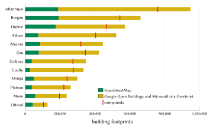
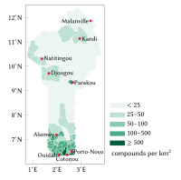
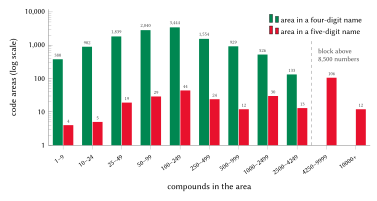
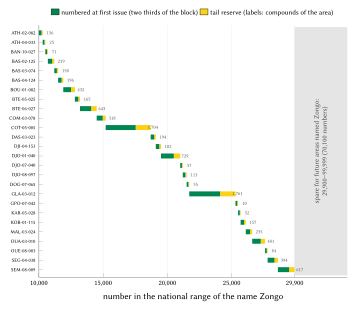
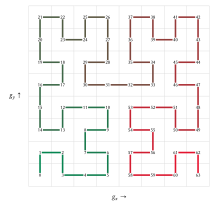
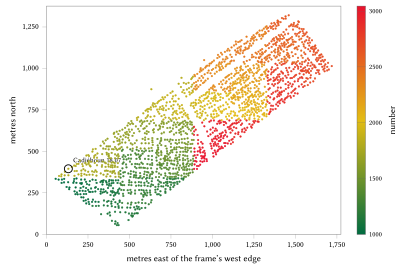
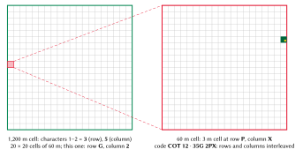

# Introduction

## The problem

An address serves three purposes. It lets a person say where they live in a form that someone else can act on; it gives an institution a stable reference to a place; and it brings a visitor, a courier or an ambulance crew to the right gate. In Benin no national system serves these purposes. The Universal Postal Union's addressing sheet for the country has no postcode field: a postal address is a name, a post-office box, a locality and a telephone number [@upuBenin]. Cotonou has coded its streets by arrondissement since 2013 and painted metric door numbers on part of its frontage [@hessoun2013; @osmwikiBenin], but the plates are incomplete and the data are not public. The Council of Ministers authorised a national strategy for street and door addressing on 22 April 2026 [@sgg2026], and at the time of writing no format, operator or timetable has been published. Elsewhere a home is found through its quartier, a landmark and a telephone call.

Benin had 10,008,749 inhabitants at the 2013 census [@citypop]. The population is concentrated in the south, in the Grand-Nokoué conurbation (Cotonou 679,012; Abomey-Calavi 656,358; Porto-Novo 264,320 in 2013), with Parakou (255,478) the principal city of the north. Law 2013-05 divides the territory into 12 départements, 77 communes, 546 arrondissements and 5,290 villages and quartiers de ville [@loi2013_05]. The settlement forms that an addressing model must cover are unusually varied: walled urban concessions in which several households share one gate, rooms let individually off a common yard, the stilt houses of the lake villages of Sô-Ava reached by pirogue [@gouvSoAva], the fortified earth houses (*tata somba*) of the Atacora, and dispersed hut compounds in the fields of the north.

## Contribution

This paper describes an addressing model built for Benin and the register issued with it. Our contributions are:

1. a code that people can say and remember, made of a place name already in use and a short number, yet unique in the whole country on its own, with no commune, arrondissement or telephone position added (Sections 4.2 to 4.7);
2. a numbering that is local (neighbours receive neighbouring numbers), extensible (new homes and new areas never renumber existing ones) and checkable in machine exchange (every single-digit error and every transposition of adjacent digits is detected, including errors that would land in another area of the same name) (Sections 4.8 to 4.11);
3. a metric spot code for any point, laid on the projection of the national cadastre (Section 4.12), and a rule that the State's own address is always shown first where one exists (Section 4.13);
4. an open implementation: a specification, a reference engine, the full register of 4,147,741 codes, and a server that any public body can deploy to answer exactly as the issuer does (Section 5);
5. a measured evaluation of the issued register (Section 6), a record of the designs we rejected and why (Section 7), and sourced estimates of the effects for citizens, logistics, emergency services and government (Sections 8 to 11).

## Structure of the paper

Section 2 reviews the systems that exist in Benin and the international practice. Section 3 describes the data. Section 4 sets out the model, rule by rule, with its formulas and a worked example on a real code. Section 5 describes the implementation and Section 6 evaluates the register. Section 7 records the alternatives considered. Sections 8 to 11 discuss the benefits by sector, Section 12 privacy, safety and governance, and Section 13 the limitations. Section 14 concludes.

# Background and related work

## Postal addressing: boxes, not doors

Benin has no postal code. The UPU addressing sheet (dated 11/2025) gives five lines: addressee, post-office box, locality, telephone number and country, with the example `10 BP 648 / COTONOU` [@upuBenin]. In Cotonou, Porto-Novo, Abomey and Parakou the two digits placed before "BP" identify the post office that holds the box. They identify an office, not an area, a street or a door. A box is therefore kept as free text on a compound's record and never used as a key.

## Street addressing in Cotonou

Addressing in Cotonou has a long history. In the 1990s the Registre foncier urbain (RFU), a simplified urban cadastre financed by French cooperation in Cotonou, Porto-Novo and Parakou, combined a geocoded address (zone, block and plot) with a postal address by street and entrance; the World Bank's review notes that there was no plan to install street signs or door numbers city-wide, and that the register proved difficult to keep current [@farvacque2005, pp. 97–98]. Its investment cost was about US$15 per plot in Cotonou, US$14 in Porto-Novo and US$11 in Parakou [@farvacque2005, table 3.7].

The present plan was launched on 12 November 2013 with French cooperation, at a cost of about 330 million F CFA, beginning in the 7th and 12th arrondissements [@hessoun2013]. Each street receives a code made of its arrondissement and a three-digit number ("Rue 12.217" is street 217 of the 12th arrondissement), and each door a number roughly equal to the metres from the start of the street, odd on one side and even on the other; the mayor's residence was given as "N° 43, Rue 12.217" [@hessoun2013; @osmwikiBenin]. The plates and painted numbers are incomplete, no progress report after 2015 has been found, and the Commune's door data are not public. In OpenStreetMap, 307 ways in central Cotonou carry a code of the plan.

## The national strategy of April 2026

On 22 April 2026 the Council of Ministers adopted the principle of a national strategy for the standardisation and supervision of the addressing of streets and doors, aiming at "un nouveau système d'adressage innovant et participatif, numérique et géolocalisé", and authorised a mission with a specialised firm to implement it first in the Grand-Nokoué towns (Abomey-Calavi, Cotonou, Ouidah, Porto-Novo, Sèmè-Podji) and in Parakou [@sgg2026; @bwt2026; @srtb2026]. No ministry, format, platform or timetable had been published by 21 October 2026. The model described here is designed to sit beside that programme: its codes begin with a place name and so cannot be confused with any numeric code the State issues, and the register is published so that it can be mapped to, or transferred to, the national system.

## Land is not an address

Land rights are recorded under the Code foncier et domanial (Law 2013-01 as amended by Law 2017-15) [@loi2017_15]. The national cadastre of the Agence nationale du domaine et du foncier (ANDF) identifies parcels by a unique parcel number, îlot and parcelle, and title number, on a map in WGS 84 / UTM zone 31N [@andf]. These references identify land, not the point where a courier stops, and the model never uses them as addresses. The cadastre's projection is, however, the natural grid for the spot codes of Section 4.12.

## International practice and standards

The UPU's S42 standard defines the components of postal addresses and per-country templates for rendering them [@upuS42], and ISO 19160-1 gives a conceptual model of addressing that allows address systems to be mapped onto one another [@iso19160]. Both assume that an address system exists; neither prescribes how to create one. The UPU's *Addressing the world* argues that an address is a precondition of postal, civic and commercial services [@upu2012]. The World Bank's study of street addressing in African cities is the most directly relevant body of evidence: across 21 cities it found that 92 % of streets had no name before addressing, that conventional addressing cost on average US$5.7 per doorway and US$0.6 per inhabitant, and that systems decay when they are not used and maintained [@farvacque2005, table 3.1]. The design of Section 4 starts from the names people already use for this reason.

## Grid codes and digital addresses

A second family of systems derives a code from coordinates alone. Open Location Code (Plus Codes) encodes a latitude–longitude cell in a base-20 alphabet [@olc]; national digital-address systems in the region, such as Ghana's, compute a code for any position from a national grid [@ghanapost2017]. Such codes are universal and need no register, but they carry no place name that people use, mix letters and digits, and give different codes to two points of the same compound. Letters are a particular difficulty in Benin: in French several letter names rhyme ("cé", "pé", "vé"), and in Fon "c" is read "tch", "x" denotes a velar fricative and "q" does not exist. We therefore use a grid code only for points that are not compounds (Section 4.12), and give compounds a registered code built on a name.

# Data and sources

The model was computed from the following data, listed with their licences in `SOURCES.md` and `LICENSING.md`.

- **Building footprints.** 5,174,482 footprints: 1,040,021 from OpenStreetMap [@neis2014; @geofabrik] and 4,134,461 from the Google Open Buildings [@sirko2021] and Microsoft [@msbuildings] datasets, taken through the Overture Maps buildings theme [@overture] where OpenStreetMap has no building. Figure 1 shows the sources by département: OpenStreetMap supplies between 8 % (Couffo) and 34 % (Littoral) of footprints.
- **Places.** 13,443 OpenStreetMap place points (quartier, village, hamlet, neighbourhood, suburb, town, city, locality) of the extract of 17 October 2026, which give the code areas their names.
- **Boundaries.** The 546 arrondissements of geoBoundaries [@runfola2020] and the 77 communes of OCHA's common operational dataset [@ochaCod].
- **Official streets.** The 307 ways of central Cotonou that carry a code of the 2013 plan in OpenStreetMap.
- **Walls, fences and gates.** Mapped enclosures and gates from OpenStreetMap, used to group buildings into compounds.

{#fig:footprints width=92%}

Figure 2 shows the resulting density of compounds by commune, from under 25 per km² in most communes of the north to about 1,300 per km² in Cotonou and 1,400 in Porto-Novo.

{#fig:communes width=62%}

# The model

## Design requirements

We fixed the requirements, in order of priority, before choosing any form:

1. **Memorable and effortless.** A resident must be able to say the code from memory after hearing it once, and to obtain it in one step.
2. **Unique on its own.** The code must name one compound in the country without a commune, arrondissement or position.
3. **The compound and its gate.** The unit is the compound (*concession*); its buildings are sub-units; navigation ends at the gate.
4. **The State first.** Where the State gives an address, it is shown first, exactly as written.
5. **Never mistaken for an official code.** The code must not resemble a Cotonou street code, a post-office box or any numeric code the State may issue.
6. **Offline and stable.** The code must be decodable without a network, must never move and must never be reused.
7. **Places, never people.**

## The forms of a code

Every compound has three forms of one code (Table 1). The remembered form is what people say; the written form is the same text with the separator; the machine form is what systems exchange.

| Form | Example | Used by |
|:--|:--|:--|
| Remembered | Cadjéhoun 18 07, said "Cadjéhoun, dix-huit, zéro sept" | residents, callers, drivers |
| Written | Cadjéhoun · 18 07 | plates, forms, parcels, messages |
| Five-digit name | Sainte Rita · 12 403, said "douze, quatre cent trois" | the areas of the 134 names that need five digits |
| Machine | BJ-COT-12-001-1807-4 | applications, QR codes, partners |
| Sub-units | BJ-COT-12-001-1807-4.2 and /2 | structure 2 of the compound; entrance 2 |
| Spot | COT 12 · 35G 2PX | any point: a stall, a field, a landing |

: The forms of one code. {#tbl:forms}

Let $P$ be the plate name of the compound's area, $N$ its number, $C$ the three-letter commune key, $A$ the two-digit arrondissement number, $Q$ the three-digit index of the area in its arrondissement, $\iota$ the five-digit national index of the plate name and $c$ the check digit. Then

$$
\text{written} = P \;\cdot\; \sigma(N), \qquad
\text{machine} = \texttt{BJ-}C\texttt{-}A\texttt{-}Q\texttt{-}N\texttt{-}c, \qquad
c = \operatorname{Damm}(\iota \,\|\, N)
\tag{1}
$$
where $\sigma(N)$ writes a four-digit number as two pairs ($1807 \mapsto 18\ 07$, as telephone numbers are read in French) and a five-digit number as a pair and a hundred ($12403 \mapsto 12\ 403$, as French postcodes are read), and $\|$ denotes concatenation of $\iota$ and $N$, each written on five digits. The separator "·" keeps a name that ends in a digit ("Ganvié 1 · 12 03") apart from its number; typed input need not carry it. The check digit appears only in the machine form: people never see, say or type it.

## Code areas

The machine form rests on the 546 arrondissements of the 77 communes. A *code area* is a named place of an arrondissement: an OpenStreetMap place point; an arrondissement with no named place forms one area, index 000. There are 12,964 areas. Each footprint $f$ takes the nearest place point of its own arrondissement $\operatorname{arr}(f)$:

$$
\operatorname{area}(f) = \operatorname*{arg\,min}_{a \in \operatorname{arr}(f)}
\Big[ (\lambda_f - \lambda_a)^2 \cos^2 \varphi_f + (\varphi_f - \varphi_a)^2 \Big]
\tag{2}
$$
where $\varphi$ and $\lambda$ are latitude and longitude. The 18,374 footprints that fall in no arrondissement polygon (on the coast, the lagoons and the borders) take the nearest place point in the country. Each area is frozen at issue with its key, its block of numbers and its *frame* $(x_0, y_0, x_1, y_1)$: the bounding box of its footprints' centres widened by $0.0005^\circ$ (about 55 m) on every side. 12,845 areas hold compounds; the largest, Ladji Farani in Parakou, holds 23,009. Figure 3 shows the distribution: the median area holds 110 compounds.

{#fig:sizes width=95%}

## Compounds

Footprints are grouped into compounds before any number is given, one area at a time and in a fixed order of stable identifiers (Table 2). The distance between two footprints $a$ and $b$ is the shortest distance between their outlines,

$$
d(a,b) = \min_{p \in \partial a,\; q \in \partial b} \lVert p - q \rVert, \qquad d(a,b) = 0 \text{ if } a \cap b \neq \varnothing.
\tag{3}
$$

| Rule | Condition | Effect |
|:--|:--|:--|
| Enclosure | the footprint's centre lies inside a mapped closed wall, fence or hedge of 30 to 6,000 m² | the enclosure is one compound |
| Annex | a footprint under 30 m² (kitchen, shower, guard's room) | joins the nearest footprint of at least 30 m² with $d \le 6$ m |
| Hut cluster | in the rural communes of Alibori, Atacora, Borgou and Collines (not Parakou): huts under 40 m² that belong to no house, with $d \le 3$ m | one compound of at most 25 huts |
| Single | any other footprint | its own compound |

: The grouping rules, applied in order. {#tbl:grouping}

Only annexes join a house and a hut cluster never joins two houses, so groups cannot chain across a neighbourhood. The rules produced 4,147,741 compounds from 5,174,482 footprints (1.25 footprints per compound): 3,329,544 single buildings, 739,537 houses with their annexes, 76,949 hut clusters and 1,711 mapped enclosures. The rules deliberately err towards keeping buildings apart. Merging two codes later costs nothing (the older survives, the other becomes an alias), while splitting a wrong merge would give a household a new code. Section 6.6 measures the consequence.

## Plate names

The name in a code is said on the telephone and painted on a gate, so each area carries a *plate name* of at most 12 characters and 2 words, in addition to its official name. With $\mathrm{NFC}(s)$ the Unicode normal form of $s$, counted in characters, and $L$ the set of linking words,

$$
\operatorname{plate\_ok}(s) \iff \lvert \mathrm{NFC}(s) \rvert \le 12 \;\wedge\; \lvert \operatorname{words}(s) \setminus L \rvert \le 2,
\tag{4}
$$
where $L$ = {de, du, des, d', la, le, les, l', et, sur, en, au, aux, à, es}; "es" is the Arabic article of names such as Dar Es Salam. Words are separated by spaces or hyphens.

A name over the limit passes through fixed steps, the first that succeeds being kept: cleaning (text in brackets or after a slash, and the generic words Quartier, Cité, Lotissement, Zone, Village and Campement are removed, so "Camp Peulh Soukoumpérou" becomes **Soukoumpérou**); "Saint" abbreviated to "St"; and the most distinctive run of whole words, taken only when clearly ahead of the next candidate and preferring the end of the name. A word is never cut; a binding word (Saint, Aladji, El Hadj, Orou, Bio, Sabi) never loses the word after it; a qualifier that distinguishes two places (Peulh, Bariba, Gando, Centre, Gare, an ordinal) is never dropped automatically; and a plate name may not equal a commune seat, a département or a large town unless it is the area's own. Table 3 gives the outcome.

| Outcome | Areas |
|:--|--:|
| Plate name equal to the official name | 11,134 |
| Shortened by cleaning | 70 |
| Shortened by abbreviation | 1 |
| Shortened to its most distinctive words | 460 |
| Left to the commune, with up to three candidates | 1,300 |
| of which still over the limit (mostly single words of more than 12 letters) | 681 |

: How the plate names of the 12,964 areas were set. {#tbl:plates}

The 1,300 areas left to their commune were issued under their first candidate, so no home waits for a naming decision: 391,974 codes carry a provisional name that the commune may change once. The official name remains an alias of the plate name (1,109 aliases), so typing the full name finds the same compound.

## The name key

Two plate names are the same name when they reduce to the same key,

$$
\kappa(s) = \operatorname{fold} \circ \operatorname{join} \circ \operatorname{ordinal} \circ \operatorname{article} \circ \operatorname{split} \circ \operatorname{lower} \circ \operatorname{unaccent} \circ \operatorname{gbe}(s),
\tag{5}
$$
whose steps are listed in Table 4. Folding follows the spellings by which one Gbe or Yoruba sound is written in French orthography, so it can merge two spellings of one name but never split a name in two.

| Step | Rule | Example |
|:--|:--|:--|
| gbe | ɔ → o, ɛ → e, ɖ → d, ŋ → ng, ƒ → f, ʋ → v, ɣ → g | Ɖokpa → Dokpa |
| unaccent, lower, split | accents and case removed; split on anything but a–z and 0–9 | Gbèdji → gbedji |
| article, ordinal | a leading le, la, les, l' dropped; a final Roman numeral or ordinal becomes its number | Ganvié I = Ganvié 1er → ganvie1 |
| join, fold | words joined; tch → c, dj → j, ph → f, ou before a vowel → w, doubled letters single | Ouèssè → wese; Tchetti → ceti |

: The steps of the name key, Eq. (5). {#tbl:key}

The 12,964 areas carry 10,841 distinct plate names. 1,265 names are shared, by 3,388 areas (26.1 %) holding 1,140,780 compounds; the most repeated are Zongo (26 areas), Kpodji (20), Kpota (19), Gbèdji (15) and Fifadji (11).

## National ranges and blocks

Every name owns one national range: $[1000, 9999]$ for a four-digit name, $[10000, 99999]$ for a five-digit one. Let a name be carried by areas $1, \dots, k$, in the frozen order of their keys (commune, arrondissement, area), holding $n_1, \dots, n_k$ compounds at issue. Each area receives a block of

$$
B(n) = \max\!\Big(200,\; 100 \left\lceil \frac{2n}{100} \right\rceil\Big)
\tag{6}
$$
numbers: twice its compounds, in whole hundreds, at least 200. With $T = \sum_i B(n_i)$ the name's total, its digit count is

$$
\delta = \begin{cases} 4 & \text{if } T + 500 \le 9\,000, \\ 5 & \text{if } T + 5\,000 \le 90\,000, \end{cases}
\tag{7}
$$
and its blocks are laid from the bottom of the range, $F_1 = 10^{\delta-1}$ and $F_{i+1} = F_i + B(n_i)$, leaving the top of the range as spare room for future areas of the name: at least 500 numbers for a four-digit name and 5,000 for a five-digit one. A name exceeding both conditions would take a qualifier; no name in Benin needs one. The largest range, Ladji Farani's, uses 46,100 of its 90,000 numbers, and the largest shared range, Gouré Tépel's (two areas), 38,800.

**Worked example: Cadjéhoun.** One area of Cotonou's 12th arrondissement with 2,046 compounds. By Eq. (6), $B(2046) = 100 \lceil 40.92 \rceil = 4100$, so the block is 1000–5099. By Eq. (7), $T + 500 = 4600 \le 9000$: the name has four digits, and 5100–9999 is spare.

**Worked example: Agata.** Three areas, in Allada (19 compounds), Cotonou (623) and Dangbo (217), with blocks 1000–1199, 1200–2499 and 2500–2999. $T = 2000$, so the name has four digits: **Agata · 15 00** is in Cotonou, **Agata · 26 00** in Dangbo, and "Agata · 45 00" lies in no block and is refused, never guessed.

**Worked example: Zongo.** The most repeated name: 26 areas whose blocks total 19,900 numbers. Since $19\,900 + 500 > 9\,000$, the name has five digits, with blocks 10000–29899 and 70,100 numbers spare (Figure 4).

{#fig:zongo width=92%}

Of the 10,841 names, 10,707 have four digits and 134 have five; 12,665 areas have four digits and 299 five. By compound, 3,241,198 codes (78.1 %) have four digits and 906,543 (21.9 %) five. Five-digit areas are mostly towns that OpenStreetMap names with a single point (Ladji Farani, Lokossa, Tanguiéta, Malanville, Porto-Novo) and the most repeated names. Blocks never move, shrink or get renumbered; a new area with an existing name, or an area whose block is full, takes the next block above every block of its name.

## Numbering within an area

Compounds are numbered along a Hilbert curve [@hilbert1891] of order 16 laid over the area's frozen frame, so that compounds close on the ground receive close numbers [@moon2001]. The reference point of a compound is its gate once confirmed, otherwise the centre of its largest building. The point $(\lambda, \varphi)$ is first mapped to the integer grid

$$
g_x = \left\lfloor \frac{\lambda - x_0}{x_1 - x_0}\,(2^{16}-1) \right\rfloor, \qquad
g_y = \left\lfloor \frac{\varphi - y_0}{y_1 - y_0}\,(2^{16}-1) \right\rfloor,
\tag{8}
$$
and its distance $h$ along the curve is accumulated over the bits of the grid, for $s = 2^{15}, 2^{14}, \dots, 1$:

$$
r_x = \Big\lfloor \frac{g_x}{s} \Big\rfloor \bmod 2, \quad
r_y = \Big\lfloor \frac{g_y}{s} \Big\rfloor \bmod 2, \quad
h \leftarrow h + s^2\,\big((3 r_x) \oplus r_y\big),
\tag{9}
$$
after which, if $r_y = 0$, the quadrant is rotated: if $r_x = 1$ then $(g_x, g_y) \leftarrow (2^{16}-1-g_x,\; 2^{16}-1-g_y)$, and then $g_x$ and $g_y$ are exchanged. Here $\oplus$ is bitwise exclusive or. Figure 5 shows the order-3 curve. The $n$ compounds of an area with block $[F, F+B)$, sorted by $(h, \text{stable id})$ and indexed $i = 0, \dots, n-1$, receive

$$
N_i = F + i \cdot \Delta, \qquad \Delta = \max\!\Big(1, \Big\lfloor \frac{M}{n} \Big\rfloor\Big), \qquad M = \Big\lfloor \frac{2B}{3} \Big\rfloor,
\tag{10}
$$
so that the first two thirds of the block are spread over today's compounds and the top third, $[F + M, F + B)$, is a tail reserve kept free at issue.

{#fig:hilbert width=48%}

**Worked example: Cadjéhoun 18 07.** The compound's reference point is $\varphi = 6.3582212$, $\lambda = 2.3911161$, and Cadjéhoun's frame is $(2.389926, 6.354647, 2.405961, 6.367091)$. By Eq. (8), $g_x = \lfloor 0.0011901/0.016035 \times 65535 \rfloor = 4863$ and $g_y = \lfloor 0.0035742/0.012444 \times 65535 \rfloor = 18823$; Eq. (9) gives $h = 969\,741\,632$, the 808th of 2,046 compounds along the curve ($i = 807$). With $B = 4100$, $M = \lfloor 8200/3 \rfloor = 2733$ and $\Delta = \max(1, \lfloor 2733/2046 \rfloor) = 1$, Eq. (10) gives $N = 1000 + 807 = 1807$; the tail reserve is 3733–5099. Figure 6 shows every compound of Cadjéhoun coloured by its number.

{#fig:cadjehoun width=92%}

## New compounds

A new compound takes the area of the nearest issued code within 250 m, so that it joins its neighbours; failing that, the area containing the point; failing that, the nearest area. Within the area, let $a$ be the number of its predecessor on the curve (at or before its position $h$) and $b$ that of its successor. It receives

$$
N^{*} = \operatorname*{arg\,min}_{v \in (a, b) \setminus U,\; v < F + M} \Big( \Big\lvert v - \frac{a+b}{2} \Big\rvert,\; v \Big),
\tag{11}
$$
where $U$ is the set of numbers already used or retired; if no such $v$ exists it takes the lowest free number of the tail reserve, and a full block takes an extension block of its name. In Cadjéhoun $\Delta = 1$, so a house built between two numbered neighbours receives **Cadjéhoun · 37 33**, the first number of the tail reserve; where the step is larger, new houses take numbers between their neighbours.

## Decoding

Decoding needs neither a commune nor a position:

$$
\operatorname{decode}(P, N) = \big\{\, a \;:\; \kappa(P) \in \{\kappa(a)\} \cup \operatorname{aliases}(a),\;\; \lvert N \rvert = \delta(\kappa(P)),\;\; N \in \operatorname{blocks}(a) \,\big\}.
\tag{12}
$$

Because the blocks of a name are disjoint, the set has at most one element. Text is read as a name and a number of four or five digits, with or without the separator, in pairs or not. A number in no block, in a name's spare space or with the wrong digit count is reported as not issued and never guessed. A commune written after a comma must be the area's, or the code is refused: "Agata · 15 00, Cotonou" is accepted and "Agata · 15 00, Dangbo" refused.

## The check digit

The machine form carries a check digit computed with Damm's algorithm [@damm2004] over the ten digits $d_1 \dots d_{10}$ of $\iota \,\|\, N$:

$$
c_0 = 0, \qquad c_k = T[c_{k-1}][d_k] \quad (k = 1, \dots, 10), \qquad c = c_{10},
\tag{13}
$$
where $T$ is the operation table of a totally anti-symmetric quasigroup of order 10 (Table 5). Such a check detects every single-digit error and every transposition of two adjacent digits.

| $T$ | 0 | 1 | 2 | 3 | 4 | 5 | 6 | 7 | 8 | 9 |
|:-:|:-:|:-:|:-:|:-:|:-:|:-:|:-:|:-:|:-:|:-:|
| **0** | 0 | 3 | 1 | 7 | 5 | 9 | 8 | 6 | 4 | 2 |
| **1** | 7 | 0 | 9 | 2 | 1 | 5 | 4 | 8 | 6 | 3 |
| **2** | 4 | 2 | 0 | 6 | 8 | 7 | 1 | 3 | 5 | 9 |
| **3** | 1 | 7 | 5 | 0 | 9 | 8 | 3 | 4 | 2 | 6 |
| **4** | 6 | 1 | 2 | 3 | 0 | 4 | 5 | 9 | 7 | 8 |
| **5** | 3 | 6 | 7 | 4 | 2 | 0 | 9 | 5 | 8 | 1 |
| **6** | 5 | 8 | 6 | 9 | 7 | 2 | 0 | 1 | 3 | 4 |
| **7** | 8 | 9 | 4 | 5 | 3 | 6 | 2 | 0 | 1 | 7 |
| **8** | 9 | 4 | 3 | 8 | 6 | 1 | 7 | 2 | 0 | 5 |
| **9** | 2 | 5 | 8 | 1 | 4 | 3 | 6 | 7 | 9 | 0 |

: Damm's quasigroup table $T$ (row: interim digit $c_{k-1}$; column: next digit $d_k$). {#tbl:damm}

**Worked example.** Cadjéhoun's national index is $\iota = 2362$, so the input is 02362 ‖ 01807. The interim digits are 0, 1, 2, 1, 9, 2, 2, 5, 3, 4, so $c = 4$ and the machine form is BJ-COT-12-001-1807-4. Transposing the last two digits (1870) gives check 3, and changing the last digit (1808) gives check 2; both are refused.

The area digits $C$, $A$, $Q$ are deliberately not in the check. Name and number already fix the area through the frozen blocks, so a validator rejects an altered area part because the number belongs to one block only. Putting the area digits into the sum would have two inputs change at once when a mistyped number lands in another area of the same name, and Damm's guarantee would no longer hold; over $\iota \,\|\, N$ it holds for every number of the name.

## Spot codes

All of Benin lies in UTM zone 31N, the projection of the national cadastre, so spot codes are laid on a metric grid of 3 m cells, square everywhere from Cotonou (6.4° N) to Karimama (12.4° N). A point is projected with Krüger's series to third order in $n$ [@kruger1912; @karney2011], accurate to the millimetre within the country. Each arrondissement has a frame whose south-west corner $(e_0, n_0)$ is its outline's corner rounded down to 1,000 m, with $k_x$ and $k_y$ base-20 characters per axis (three cover 24 km, four cover 480 km), over the alphabet `23456789CFGHJMPQRVWX`, which has no vowels and no characters easily confused with 0, 1 or each other. With $(e, n)$ the projected point,

$$
i_x = \Big\lfloor \frac{e - e_0}{3} \Big\rfloor, \qquad i_y = \Big\lfloor \frac{n - n_0}{3} \Big\rfloor,
\tag{14}
$$
and the code is $C\,A$ followed by the base-20 digits of $i_y$ and $i_x$, interleaved from the most significant, northing first, so that nearby points share their leading characters. 406 arrondissements need six characters, 58 seven and 82 eight. The decoded point is the centre of the cell, at most $1.5\sqrt{2} \approx 2.12$ m from any point inside it.

**Worked example.** Cadjéhoun 18 07's point lies in the frame of Cotonou's 12th arrondissement ($e_0 = 429\,000$, $n_0 = 701\,000$, $k_x = k_y = 3$). It projects to $e = 432\,659.214$, $n = 702\,843.008$. By Eq. (14), $i_x = \lfloor 3659.214/3 \rfloor = 1219 = 3 \cdot 400 + 0 \cdot 20 + 19$ and $i_y = \lfloor 1843.008/3 \rfloor = 614 = 1 \cdot 400 + 10 \cdot 20 + 14$, whose characters are 5 2 X and 3 G P. Interleaved, northing first, they give **COT 12 · 35G 2PX** (Figure 7). The decoded centre is 0.87 m from the point.

{#fig:spot width=95%}

**Points in no outline.** The arrondissement outlines come from a generalised boundary dataset, so 13,999 issued compounds (0.34 %), mostly along the northern borders of Ségbana, Malanville and Karimama, lie in no outline. Such a point takes its arrondissement among those whose outline lies within 10 km: the one with the nearest outline whose frame holds the point, distances being measured to the nearest edge with longitude differences scaled by $\cos\varphi$, and ties going to the lower commune key, then number. Frames are never moved or widened, because either would change spot codes already published, so a point that no such frame holds takes the nearest cell of a frame at most 999 m away. This applies to 158 compounds on the border with Togo, whose spot code names the frame's edge cell, at most 392 m from the reference point. The decoder is unchanged, since a spot code names its arrondissement. For example, a compound of Monsey, Karimama, at $\varphi = 12.2796011$, $\lambda = 2.9817464$, 1.4 km beyond the outline, falls in Monsey's frame and receives **KAR 05 · 349 RVMVH**.

## Official addresses first

Where the State gives an address, the model shows it first, exactly as written, and the N-Ways code beside it. In Cotonou, the coded street of the 2013 plan within 30 m of a compound is shown first ("Rue 12.202, Cotonou"); 17,948 compounds show one at issue. A door number of the plan, once known for a gate (from the Commune's data under a data-sharing agreement, or read from the plate by two residents independently), replaces the street. When the national programme delivers addresses, they will be attached to their compounds in the same way. No N-Ways code changes as a result: the code remains the means of reaching the compounds an official address does not yet cover, and of distinguishing the households of a concession that share one gate.

## The building profile

Every structure carries a use class, its confidence and source, its size, its floors where known, and a status. Classes are inferred in a fixed order of evidence: the OpenStreetMap building type (confidence 0.85), a shop, amenity or office tag on the footprint (0.75), a mapped place inside it (0.65), the footprint's size (0.3–0.4), and otherwise residential by default (0.45). Of the 5,174,482 structures, 5,152,555 are classed residential, nearly all by default; 6,651 are annexes, 6,413 commercial, 2,960 schools, 1,182 under construction, 1,055 health facilities, 1,054 offices and 1,010 places of worship. OpenStreetMap gives floors for 3,968 buildings. The heights in the machine-learned footprint datasets take only 36 distinct values between 3.5 and 7 m and are not used. A residential compound never carries a name.

# Implementation

## Specification and reference engine

The model is specified normatively in `engine/SPEC.md`, using the requirement keywords of RFC 2119 [@rfc2119]. The reference engine, `engine/reference/bj_engine.py`, implements every rule of Section 4 in the Python standard library: parsing and validation of the three forms, the name key, the national name table, the check digit, spot codes and their projection, the compound grouping and the numbering. Its 38 tests cover each rule and the worked examples of this paper. What an offline decoder needs is about 1.1 MB for the name table with its aliases (0.2 MB compressed) and 0.5 MB of arrondissement outlines; to show compound codes, an application needs the registry slice of its commune (Cotonou's is about 2 MB compressed).

## The registry

The register is published in full in `registry/`: one compressed CSV file per commune with one row per code (machine, remembered and written forms, area, official name, number, check digit, status, entrance point and kind, spot code, official address where one exists, building class and use, structures, floor area and grouping rule), the frozen area table `areas.csv.gz` (12,964 areas with their blocks, names, frame and place point), and `MANIFEST.json`, which gives the row count and the SHA-256 digest of every file. The registry holds every issued code: 4,147,741 rows in 77 commune files. All codes are provisional at issue and become confirmed when residents agree in the application; none has been retired.

## The server and its interface

The repository includes a ready-made server, `server/`, which any ministry, post office or developer can deploy with one command (`docker compose up`). It imports the published registry into SQLite, verifying every file against the manifest, and serves a JSON interface under `/v1`: the full record of a code, search by remembered form (in any spacing, case or accentuation), machine form, official address or spot code, the code at a point and the codes near it, validation of a machine code, spot codes in both directions, and communes and areas with their blocks. The code at a point follows the issuer's rule: the compound whose entrance lies within 12 m. A server designated as the issuer can also issue codes for new compounds and further doors by the rules of Sections 4.8 and 4.9, and its new blocks are written back on export in the published format. An export of an unchanged import is byte-identical to the published files. The interface is specified in `server/openapi.yaml` and documented with real requests and responses in `docs/api.md`. A deployment is read-only unless it is the designated issuer, because two issuers working independently would hand out the same number twice.

## Conformance and issuer parity

Any implementation must reproduce the conformance vectors in `engine/reference/vectors.json`, computed on the frozen register: 723 name keys, 500 complete code forms, 2,393 decodings, 648 spot codes, 776 points in no arrondissement outline (456 issued compounds among them, the frames' nearest cells and refusals), 60 projections and the numbering cases. We further verified that the server issues exactly as the N-Ways issuer does: 530 new compounds and doors in ten areas, two of them filled until they took extension blocks, received the same numbers and forms from both, and 400 points gave the same area, nearest area and spot code. A sample of 55 random codes compared field by field with the issuer's public interface (1,320 fields) showed no difference.

# Evaluation

All figures in this section are measured on the issued register by `tools/paper-evaluation.py` and recorded in `model/stats/evaluation.json`.

## Uniqueness and coverage

No machine form and no remembered form (name key and number) occurs twice among the 4,147,741 codes. Every compound found on the map at issue has a code: coverage is 100 % of mapped compounds, against 0.4 % (17,948 compounds) that can show an official Cotonou street within 30 m. The 119 areas without compounds keep their blocks for future homes.

## Digits and lengths

Of the 4,147,741 codes, 3,241,198 (78.1 %) have four-digit numbers and 906,543 (21.9 %) five. The written form, separator and spaces included, has a median of 16 characters; 95.8 % of written forms have 20 characters or fewer, and the longest whose plate name is within the limit, "Djèvié-Wadon · 10 000", has 21. The plate name is within 12 characters for 4,046,845 codes (97.6 %); the 100,896 others belong to the 681 areas whose provisional name is still over the limit (Section 4.5) and await their commune's choice. Longer codes are therefore a property of a small set of names, not of the model.

## Decoding

For a systematic sample of every twentieth row (207,387 codes), the written form decoded alone by Eq. (12), with no commune or position, gave back the machine form in every case, and every machine form passed its check digit. The decoder needs only the name table of `model/names.json`.

## Transcription errors

People do not see the check digit, so an error in a remembered code is caught only if it lands outside the issued numbers of the name. We applied every single-digit substitution and every transposition of adjacent digits to the number of a systematic sample of codes (Table 6).

| Error in the number | Errors | Another issued code of the name | Unissued number in a block | Outside every block (refused) |
|:--|--:|--:|--:|--:|
| Single-digit substitution | 1,533,235 | 67.0 % | 11.6 % | 21.4 % |
| Adjacent transposition | 106,986 | 64.0 % | 15.6 % | 20.4 % |

: Where an error in the number of a remembered code lands, for every hundredth code of the register (41,477 codes). {#tbl:typos}

In the machine form the check digit caught all 1,640,221 of these errors, as Damm's construction guarantees. In the remembered form, about one error in three is refused or reported as not issued, and about two in three name another compound. Of those, 98.2 % lie in the same area, because numbers are dense within a block and ordered along the Hilbert curve; the median distance to the intended compound is 220 m (interquartile range 71–719 m). A remembered code is therefore protected not by a check digit but by read-back: the application and the dispatcher repeat the place, and the map shows the compound and its gate before anyone travels. Section 7.2 discusses the alternative.

## Spot codes

Every code has a spot code. For every twentieth code whose reference point lies in its frame (207,380 codes), the centre of the published spot code lies a median 1.20 m from the compound's reference point, with a 99th percentile of 1.97 m and a maximum of 2.12 m, the theoretical bound of Section 4.12. The 13,999 codes (0.34 %) whose reference point lies in no arrondissement outline of the boundary dataset (Section 13), mostly along the northern borders of Ségbana, Malanville and Karimama, take the arrondissement of the nearest outline (Section 4.12); 158 of them, on the border with Togo, lie west of every frame, and their spot code names the frame's edge cell, at most 392 m from the reference point. Their compound codes are unaffected.

## Compound grouping

To test the grouping, we re-ran the rules with the 1,107 mapped walls and fences that enclose two or more buildings hidden from them. Of these enclosures, 90 (8.1 %) came out as one compound holding all their buildings, 79 of them (7.1 %) with no building from outside the wall, and a further 438 (39.6 %) missed only one building. In a Beninese concession the main house, the let rooms and the kitchen are separate buildings, and with no wall mapped the rules keep them apart on purpose (Section 4.4). The grouping is therefore a lower bound on the size of compounds, to be completed by residents ("these buildings are one home") rather than by looser rules.

## Worked examples

Table 7 gives real codes from the register: the compound nearest each of a set of well-known places.

| Near | Written form | Machine form | Spot code |
|:-----------------------|:--------------------|:--------------------------|:-------------------|
| Rue 12.202, Cotonou | Cadjéhoun · 18 07 | BJ-COT-12-001-1807-4 | COT 12 · 35G 2PX |
| Dantokpa market, Cotonou | Dantokpa · 26 13 | BJ-COT-06-008-2613-1 | COT 06 · 353 9J2 |
| Zogbo, Cotonou | Zogbo · 27 90 | BJ-COT-09-004-2790-9 | COT 09 · 359 954 |
| Place de l'Étoile Rouge | Sainte Rita · 12 403 | BJ-COT-08-001-12403-1 | COT 08 · 33V MHV |
| Université d'Abomey-Calavi | Zogbadjè · 16 320 | BJ-CAL-02-020-16320-2 | CAL 02 · 25X 87C |
| Ganvié, Sô-Ava | Ganvié · 14 20 | BJ-SOA-04-002-1420-0 | SOA 04 · 74R 4X2 |
| Porto-Novo | Porto-Novo · 15 685 | BJ-PNO-04-004-15685-6 | PNO 04 · 35Q 8R6 |
| Ouidah | Ouidah · 12 920 | BJ-OUI-03-003-12920-0 | OUI 03 · 32W MRF |
| Abomey | Azali · 12 52 | BJ-ABO-06-008-1252-8 | ABO 06 · 48H 89V |
| Bohicon | Ahouamè · 27 02 | BJ-BOH-01-001-2702-8 | BOH 01 · 424 QHX |
| Parakou | Lémanda · 13 236 | BJ-PKO-02-013-13236-4 | PKO 02 · 724 8CH |
| Djougou | Timtim-Bongo · 10 96 | BJ-DJO-01-037-1096-4 | DJO 01 · 396 6FH |
| Natitingou | Natitingou · 13 13 | BJ-NAT-03-003-1313-2 | NAT 03 · H66 JVQ |
| Malanville | Malanville · 13 768 | BJ-MAL-04-005-13768-9 | MAL 04 · J7Q 2WG |

: Codes from the issued register. {#tbl:examples}

The same name in three places: `agata 1500` lies in the block 1200–2499, the Agata of Cotonou; `agata 2600` lies in Dangbo's block 2500–2999; Allada's Agata holds 1000–1199. Nothing is chosen from a list and nothing is guessed. A system that receives `BJ-COT-12-001-1870-4`, with two digits swapped, refuses it, since the check of 1870 is 3.

# Designs considered

## Alternatives for the form

Before fixing the form we compared five designs against the requirements of Section 4.1, with a capacity rule that the numbers available must be at least twice today's compounds (Table 8).

| Design | Example | Arithmetic | Verdict |
|:--|:--|:--|:--|
| National digits only | 4817305 | $4.15 \times 10^6 \times 2 = 8.3 \times 10^6$ → 7 digits | too long, and says nothing about the place |
| Commune and digits | Cotonou 108417 | Abomey-Calavi: 378,856 compounds × 2 → 6 digits | too long |
| Arrondissement and digits | Godomey 137081 | 206 arrondissements fit 4 digits, 336 need 5, 4 need 6 | variable length; outside the cities the arrondissement is not the name people say |
| Arrondissement and base-20 characters | Godomey 7HQ2X | $20^4 = 160\,000$ | letters confused on the telephone in French and Fon |
| **Place name and number from one national range per name** | **Cadjéhoun · 18 07** | 12,665 of 12,964 areas fit 4 digits | **chosen** |

: Designs compared for the remembered form. {#tbl:designs}

Three further variants were rejected. A *Plus Code as the code* (for example 6FR4995R+7CQ) mixes letters, digits and a sign and cannot be dictated easily in French or Fon. *Name and number with the commune to tell repeats apart* (for example "Zongo 48 17, Djougou") fails because one area in four shares its name, so the commune would be needed every day, and a code written without it would be ambiguous. *Three digits for small villages* would have suited about 10,861 areas of 450 compounds or fewer, but a single length is easier to teach ("toujours deux paires"), fits one plate design and does not change when a village grows. The cost of the chosen design is measured: sharing a national range and keeping large towns whole gives 21.9 % of compounds a fifth digit, and in return no home needs anything but its place and its number.

## Alternatives for the check character

A check that detects every single error and every transposition of adjacent characters needs either an alphabet of eleven symbols with a prime modulus, as in ISBN-10's "X", or a quasigroup scheme over ten digits such as Verhoeff's [@verhoeff1969] or Damm's [@damm2004]. We chose Damm's algorithm because it uses a single table, needs no permutations and keeps the machine form numeric. We also considered placing a check digit in the remembered form. Section 6.4 shows what it would buy: about two thirds of single-digit errors in a remembered code name another compound, typically a few hundred metres away in the same area, and a visible check digit would catch them. It would also lengthen every code people say and paint by one digit, turning two pairs into an odd group of five, and the error it guards against is the one that read-back of the place and the map already expose before a journey begins. We therefore keep the check digit in the machine form, where codes pass between systems without a person to read them back, and rely on read-back for the spoken form. The measurements planned in Section 13 (digit errors when codes are dictated) will show whether this choice should be reconsidered.

## Choices settled by measurement

Several rules of the issued model differ from the first design; each was settled by a measurement.

- **Every compound, Cotonou included.** An early design gave no N-Ways number where a door was officially numbered. Every compound now has a code, with the official address shown first, so that every home can be reached in the same way.
- **Blocks from real compounds.** Blocks are sized on the compounds actually grouped, not on an estimate from a building sample. The sample-based estimate gave 47 five-digit names (222 areas); the issued register has 134 (299 areas).
- **Large towns kept whole.** Splitting areas whose block exceeds 8,500 numbers was considered. Instead, the 118 such areas take five digits and keep one block, and their official quartiers will become aliases when the communes publish them.
- **No borrowed heights.** The heights of the machine-learned footprints carry no information on floors and are not used.

# Benefits for citizens

For a family in a concession of Agla, a stilt house of Ganvié or a village of the Borgou, a code changes four ordinary things.

**Being found.** Today a visitor, a motorcycle-taxi (*zémidjan*) driver or a delivery rider is guided by telephone, landmark by landmark. With a code, the resident says one short phrase, "Cadjéhoun, dix-huit, zéro sept", and the application leads to the gate.

**Proving where one lives.** Banks, mobile-money agents, schools and employers ask for an address that almost nobody can write in a form anyone can check. At issue, 0.4 % of compounds can show an official street within 30 m; 100 % have a code.

**Receiving goods and services.** Relatives abroad, shops, and water and electricity services can send to a code rather than to a description, and a household can request a connection or a repair at the right gate.

**Simplicity.** Nothing is asked of the household. Every compound on the map had its code from 20 October 2026, and the application shows it in one step. It is free, requires no document and holds no personal data. It is not a land title.

The benefit is largest for those least served today: villages far from main roads, the lake villages, the hut compounds of the north, tenants of a concession who share one gate, and residents who do not read French well, for whom a place they know and two pairs of digits are easier than a street name.

# Logistics and commerce

Delivery in Benin relies on the telephone and the motorcycle. The machine form gives a logistics business a stable key for every customer, resolves to the gate (or to the main building until the gate is confirmed), and carries a check digit so that a mistyped machine code is caught at entry. Because the registry and the engine are open, any business can resolve codes in its own systems, offline, at no charge. The port of Cotonou serves a corridor that reaches far inland: importers, transit agents and the traders of Dantokpa can address goods and payments to a compound, and a cotton or cashew cooperative of the Borgou can list its members' compounds rather than their villages alone. La Poste du Bénin can deliver to a gate rather than to a box.

**Estimate.** Industry sources put the average cost of a last-mile delivery attempt in Africa at about US$2.70 and report first-attempt success rates as low as 60 % [@odeloye2023]. Let $f_0$ be the share of first attempts that fail, $\rho$ the share of those failures that a precise code removes, and $c_a$ the cost of an attempt. The saving per 1,000 deliveries is

$$
S = 1000 \cdot f_0 \cdot \rho \cdot c_a.
\tag{15}
$$

With $c_a = \text{US}\$2.70$, a central case of $f_0 = 0.20$ and $\rho = 0.5$ gives $S = \text{US}\$270$ per 1,000 deliveries. Over the ranges $f_0 \in [0.10, 0.40]$ and $\rho \in [0.25, 0.75]$, $S$ lies between US$68 and US$810. Neither $f_0$ nor $\rho$ has been measured in Benin; Section 13 lists the measurements that would fix them.

# Emergency services

An ambulance, fire crew or police patrol faces the courier's problem with more at stake. A qualitative study of emergency medical services in Kigali found that locating patients depended on the local knowledge of caller and crew and required several calls [@hunt2023]. Benin's emergency numbers are 112 (SAMU), 116 and 117 (police) and 118 (fire service) [@arcep2026]; we know of no published measurement of their time to locate a caller.

A code helps a dispatcher in four steps. The caller says one phrase ("Agata, quinze, zéro zéro"), and the registry returns one compound, in Cotonou, not the Agata of Dangbo or Allada. The dispatcher reads back the place, its commune and the gate. The crew drives to the gate, and a spot code marks a point that is not a compound, such as a crash on a highway. All of this works offline.

**Estimate.** Larsen and colleagues modelled survival after witnessed out-of-hospital cardiac arrest in ventricular fibrillation as 67 % less 2.3 percentage points per minute to cardiopulmonary resuscitation, 1.1 per minute to defibrillation and 2.1 per minute to advanced care [@larsen1993]. Where one crew brings all three, a delay $\Delta t$ in finding the gate shifts all three intervals, and the expected loss in survival is

$$
\Delta P = (\beta_{\mathrm{CPR}} + \beta_{\mathrm{D}} + \beta_{\mathrm{ACLS}})\,\Delta t = 5.5\,\Delta t \quad \text{percentage points},
\tag{16}
$$
that is 5.5 points for one minute, 11 for two and 27.5 for five, within the range over which the linear model holds. These figures come from a high-income setting and apply to a specific class of arrest; for Benin they indicate an order of magnitude, not a prediction.

# Government coordination and planning

A code is a shared key. When ministries, communes, utilities and the national statistics institute refer to a compound by the same code, their records can be joined without matching names and descriptions.

**One reference for all services.** An address directory gives a list of premises more complete than a tax roll and reveals who is missing from it [@farvacque2005]. The national programme can start from a register of 4,147,741 compounds, each with a position and a code, and the register can be mapped to its addresses, or transferred to it, as they are delivered.

**A code that outlives reforms.** Communes and arrondissements are labels derived from a compound's position. When a boundary moves, every code keeps working, and the area key in the machine form does not change.

**The census.** A table of codes against enumeration areas would give the next census a frame of 4,147,741 compounds to sample from and return to, without storing any name.

**Access to services.** Straight-line distances from a random sample of 20,000 compounds to the nearest mapped facility are given in Table 9. They describe the map as much as the country, since village health posts and police stations are sparsely mapped; a ministry can replace the facility list with its own and recompute them in minutes.

| Facility | Within 2 km | Within 5 km | Median distance |
|:--|--:|--:|--:|
| Health facility | 48.0 % | 70.7 % | 2.2 km |
| School | 50.4 % | 73.2 % | 2.0 km |
| Police | 19.7 % | 34.3 % | 8.9 km |
| Pharmacy | 24.9 % | 39.4 % | 7.9 km |

: Straight-line distance from 20,000 sampled compounds to the nearest mapped facility. {#tbl:access}

**Estimate.** A conventional door-numbering survey of the same compounds would cost

$$
C = N \cdot c_d,
\tag{17}
$$
where $N = 4\,147\,741$ is the number of compounds and $c_d$ the cost per doorway. At the World Bank's average of US$5.7 per doorway across 21 African cities [@farvacque2005, table 3.1], $C \approx \text{US}\$23.6$ million; at the per-plot cost of Cotonou's urban land register (US$11–15 [@farvacque2005, table 3.7]), $C$ lies between US$45.6 and US$62.2 million. Both costs are at the prices of their time and exclude maintenance. The register does not replace signage, which the State may still choose to install, but it removes the survey and numbering step and provides the list of compounds that signage would follow.

# Privacy, safety and governance

**Privacy.** Codes describe places, never people. Residential compounds carry no name and no occupant data; businesses and public buildings may show the name they publish. No identity number is collected, and nothing links a code to a personal identifier. The processing of personal data in the application (telephone numbers, gate photographs) falls under Book V of the Code du numérique, supervised by the Autorité de protection des données à caractère personnel (APDP), which requires a prior declaration and an authorisation for transfers abroad and for links between files [@loi2017_20]. A household may ask for its entrance to be hidden from the public map; the code remains valid for a visitor who has it.

**Safety.** An address is neither a land title nor a list for eviction. Data at the level of a compound beyond the published register (who confirmed what, photographs, household descriptions) are released only on a court order, with a public report of the request.

**Governance.** A single issuer maintains the register, so that no two compounds share a code. Areas, blocks and frames are frozen, codes never move, and regrouping never changes an issued code: if two compounds prove to be one, the older code survives and the other becomes an alias; if one proves to be two, the part with the gate keeps its code. A commune may rename an area (the old name remains an alias), choose a provisional plate name once, or add areas. Cotonou's addresses and the national programme's belong to the State: the model shows them as written, never edits them, and reports any mismatch observed on the ground to their holder. The repository is structured so that it can be transferred to the State or to a body it designates, under its open licences, without forking the engine.

# Limitations and future work

- **The area list rests on OpenStreetMap.** Place points are unevenly mapped; names and spellings need confirmation by residents and communes, and towns mapped with a single point form very large areas with five-digit numbers. When the annex of Law 2013-05 is available in machine-readable form, its names will be mapped onto the areas as aliases.
- **Provisional plate names.** 1,300 plate names, 681 of them over the limit, await their communes' choice.
- **Compounds are inferred.** Few walls are mapped; most compounds are single buildings or a house with its annexes (Section 6.6).
- **Building use is mostly a default**, and floors are almost always unknown.
- **Boundaries.** The arrondissement outlines come from geoBoundaries, not from an official file, and are inaccurate in places (two of Cotonou's arrondissements are missing; the Sô-Ava outlines misplace Ganvié). Because each compound's area is frozen in the register, a corrected outline changes no code.
- **Official data.** Cotonou's door numbers are not open; until they are shared, Cotonou shows its streets, and door numbers only where residents confirm them.
- **Gates are largely unknown**: most codes lead to the main building until gates are confirmed.
- **Spot codes at the borders.** 13,999 compounds whose reference point lies outside every arrondissement outline take the arrondissement of the nearest outline for their spot code (Section 6.5); for 158 on the border with Togo, west of every frame, the spot code names the frame's edge cell, up to 392 m away, because frames never move. A corrected outline changes no compound code.
- **Errors in the spoken form.** Two thirds of single-digit errors in a remembered code name another issued compound (Section 6.4); read-back and the map are the safeguard, and their effectiveness is still to be measured.

Future work will measure what the estimates of Sections 9 to 11 assume (Table 10).

| Measure | Method | Target |
|:--|:--|:--|
| Recall of one's own code after one week | residents asked without the application, in French, Fon and Bariba | at least 80 % exact |
| Digit errors when a code is dictated by telephone | recorded calls with partner couriers | under 5 % |
| First-attempt delivery success | partner couriers, with and without a code | at least 20 points higher |
| Time from arrival in the quartier to the gate | courier application timestamps | halved |
| Gates confirmed; door numbers attached in Cotonou | residents and couriers | 50,000 |

: Measurements planned to replace the assumptions of the impact estimates. {#tbl:measures}

# Conclusion

Benin has no postcode and, outside part of Cotonou, no address at the door. We have shown that an address can be given to every compound in the country in a form that residents already half know: the name of their quartier or village and two pairs of digits. A single national range per name makes the code unique on its own; frozen blocks sized on real compounds, with a tail reserve and spare space, make it stable as the country builds; a Hilbert-ordered numbering makes it local; and a check digit hidden in the machine form makes it safe to exchange. The register of 4,147,741 codes was issued on 20 October 2026 and is published in full with its specification, reference engine and server, so that the State, or any body it designates, can verify every rule, answer exactly as the issuer does, and take over the register.

# Data and code availability {-}

The specification, reference engine, register, server, tools and this paper are published at <https://github.com/n-ways/open-addresses-benin>. Code is licensed under the Apache License 2.0, data under the Open Database License 1.0 and documents under CC BY 4.0. Every use should credit: "N-Ways Addressing for Benin, © N-WAYS LIMITED (nways.ng)". The data in the figures are produced by `tools/paper-figures.py` and the evaluation by `tools/paper-evaluation.py`, from the published files only.

# Acknowledgements {-}

The model is built on OpenStreetMap data (© OpenStreetMap contributors, ODbL), the Google Open Buildings dataset (CC BY 4.0), Microsoft's building footprints (ODbL) distributed through the Overture Maps Foundation, geoBoundaries (ODbL) and the commune boundaries of the UN Office for the Coordination of Humanitarian Affairs (CC BY-IGO). We thank the mappers of Benin whose work on places, buildings and Cotonou's street codes made it possible.

# References {-}

::: {#refs}
:::
